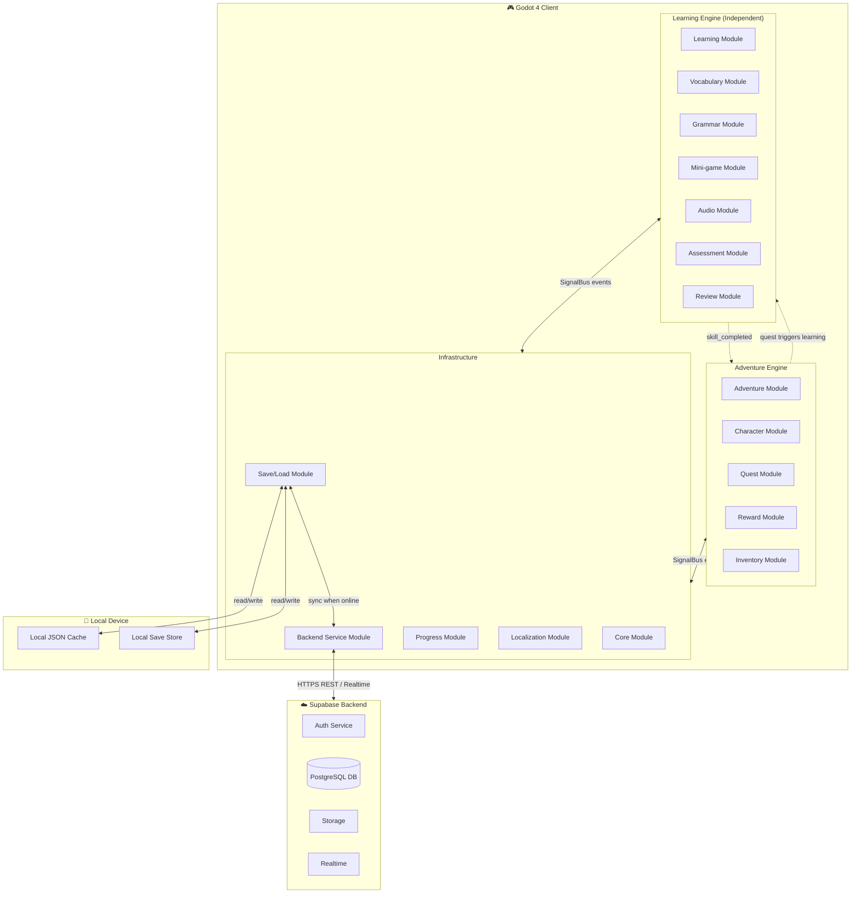
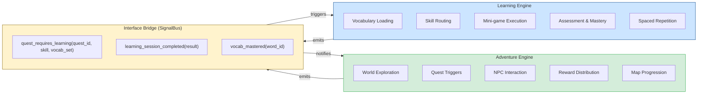
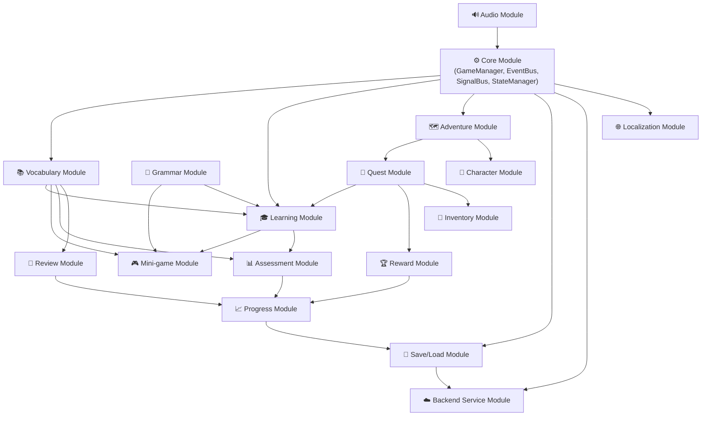
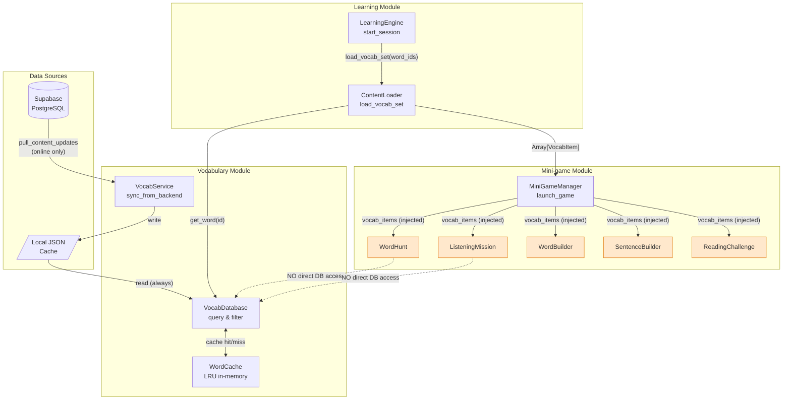
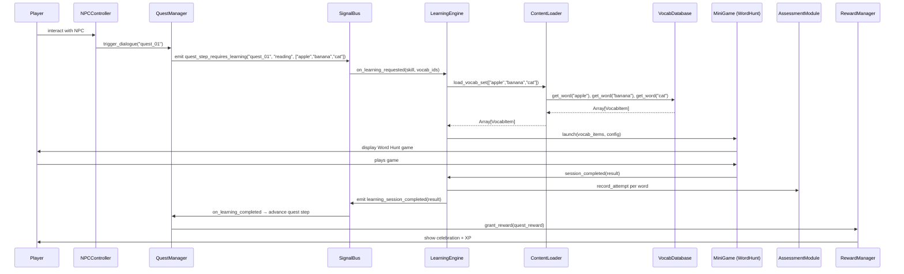
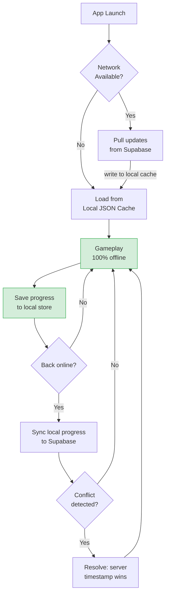
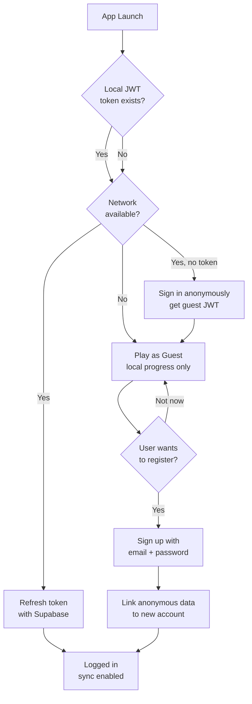
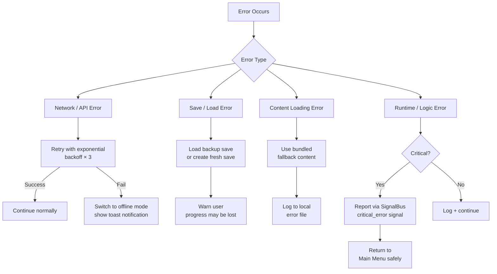

# ARCHITECTURE.md — English Adventure

> **Engine:** Godot 4.x + GDScript  
> **Backend:** Supabase + PostgreSQL  
> **Platforms:** Android · iOS · Web/Desktop  
> **Target Audience:** Children age 10, Vietnamese-speaking beginners learning English  
> **Genre:** 3D/2.5D Cartoon Adventure (Fantasy Adventure style)  
> **Last Updated:** 2026-11-26

---

## Table of Contents

1. [Architecture Overview](#1-architecture-overview)
2. [Godot 4 Module Breakdown](#2-godot-4-module-breakdown)
3. [Data Flow](#3-data-flow)
4. [Signal / Event System](#4-signal--event-system)
5. [Backend Architecture](#5-backend-architecture)
6. [Platform Considerations](#6-platform-considerations)
7. [Error Handling and Security](#7-error-handling-and-security)

---

## 1. Architecture Overview

### 1.1 Core Philosophy

English Adventure is built on three non-negotiable architectural principles:

| Principle | Rationale |
|---|---|
| **Learning Engine is INDEPENDENT from Adventure Engine** | Learning content and progression logic can be tested, updated, and reused without touching any adventure/gameplay code |
| **Vocabulary data is never duplicated** | A single `VocabDatabase` feeds every mini-game, every quest, every NPC dialogue |
| **Offline-first** | Children in Vietnam often have unreliable internet; all core gameplay works fully offline |

### 1.2 High-Level System Overview



### 1.3 Separation of Concerns: Learning Engine vs Adventure Engine



> [!IMPORTANT]
> The Learning Engine has **zero imports** from the Adventure Engine. It communicates exclusively through the SignalBus. This means the entire learning subsystem can be unit-tested in isolation, or even extracted into a separate app.

---

## 2. Godot 4 Module Breakdown

Each module lives in its own Godot autoload or scene directory. The module tables below describe: **responsibilities**, **dependencies**, and **public API** (key signals + methods).

### Module Dependency Graph



---

### 2.1 Core Module

**Path:** `res://modules/core/`  
**Autoloads:** `GameManager`, `EventBus`, `SignalBus`, `StateManager`

#### Responsibilities
- Application lifecycle (boot, pause, resume, quit)
- Global game state machine (MainMenu → Loading → Gameplay → MiniGame → Paused)
- Central event bus for decoupled inter-module communication
- Scene transitions with animated loading screens

#### Dependencies
- None (all other modules depend on Core)

#### Public API

```gdscript
# GameManager
func change_scene(scene_path: String, transition: String = "fade") -> void
func pause_game() -> void
func resume_game() -> void
func get_current_state() -> GameState

# StateManager
func push_state(new_state: GameState) -> void
func pop_state() -> void
func get_state_stack() -> Array[GameState]

# SignalBus (global signals — see Section 4 for full list)
signal scene_changed(scene_path: String)
signal game_paused
signal game_resumed
signal critical_error(error_code: int, message: String)
```

---

### 2.2 Adventure Module

**Path:** `res://modules/adventure/`  
**Key Classes:** `WorldManager`, `MapController`, `ExplorationSystem`

#### Responsibilities
- Loading and unloading 3D/2.5D worlds (Alphabet Island, Vocabulary Forest, etc.)
- World map state: locked/unlocked zones, visited locations
- Player position persistence and fast-travel
- World event triggers (entering a zone → emit signal for Quest Module)
- Parallax background management (2.5D depth layers)

#### Dependencies
- Core Module, Quest Module, Character Module, Save/Load Module

#### Public API

```gdscript
# WorldManager
func load_world(world_id: String) -> void
func get_current_world() -> WorldData
func unlock_world(world_id: String) -> void

# MapController
func travel_to_zone(zone_id: String) -> void
func get_zone_state(zone_id: String) -> ZoneState  # locked/unlocked/completed

# ExplorationSystem
func register_interactable(node: Node3D, interaction_data: Dictionary) -> void
signal zone_entered(zone_id: String)
signal interactable_activated(interactable_id: String)
```

#### World Registry

| ID | Name | Skill Focus | Status |
|---|---|---|---|
| `world_01` | Alphabet Island | Letters A–Z, Phonics | MVP |
| `world_02` | Vocabulary Forest | Nouns, Verbs, Adjectives | Post-MVP |
| `world_03` | Sentence Kingdom | Grammar, Sentence Building | Post-MVP |
| `world_04` | Listening Ocean | Listening Comprehension | Post-MVP |
| `world_05` | Speaking City | Speaking Practice | Post-MVP |
| `world_06` | Challenge Kingdom | All Skills Combined | Post-MVP |

---

### 2.3 Character Module

**Path:** `res://modules/character/`  
**Key Classes:** `PlayerController`, `BuddyController`, `NPCController`

#### Responsibilities
- Player avatar control (boy/girl selection, movement, animation state machine)
- Buddy (dragon companion) AI: follow, idle animations, hint system, reaction to learning events
- NPC lifecycle: spawn, dialogue trigger, quest-giver state, idle behavior
- Character customization data (cosmetics, unlocked outfits)

#### Dependencies
- Core Module, Quest Module, Inventory Module, Audio Module

#### Public API

```gdscript
# PlayerController
func set_avatar(avatar_id: String) -> void   # "boy" | "girl"
func move_to(target: Vector3) -> void
func play_emote(emote_id: String) -> void
signal player_interacted_with_npc(npc_id: String)

# BuddyController
func show_hint(hint_key: String) -> void
func celebrate(intensity: int) -> void       # 1=small, 2=medium, 3=big
func set_mood(mood: BuddyMood) -> void

# NPCController
func get_npc(npc_id: String) -> NPCData
func trigger_dialogue(npc_id: String, dialogue_id: String) -> void
signal npc_quest_accepted(npc_id: String, quest_id: String)
```

#### Key Characters

| Character | Role | Notes |
|---|---|---|
| Main Boy / Girl | Player avatar | Selectable at start |
| Buddy | Dragon companion | Always present, gives hints |
| Professor Owl | Tutor NPC | Introduces letters/words |
| World NPCs | Quest givers | Per-world unique characters |
| World Bosses | Final challenge gatekeepers | Defeated by completing all quests |

---

### 2.4 Quest Module

**Path:** `res://modules/quest/`  
**Key Classes:** `QuestManager`, `QuestTracker`, `DialogueSystem`

#### Responsibilities
- Quest definitions loaded from JSON (no hardcoded quest logic)
- Quest state machine: Available → Active → InProgress → Completed → Rewarded
- Multi-step quest tracking with branching conditions
- Dialogue trees: NPC conversations, hint dialogue, story narration
- Quest completion triggers learning sessions via SignalBus

#### Dependencies
- Core Module, Learning Module (via SignalBus only), Reward Module, Save/Load Module

#### Public API

```gdscript
# QuestManager
func get_available_quests(zone_id: String) -> Array[QuestData]
func accept_quest(quest_id: String) -> void
func complete_quest_step(quest_id: String, step_id: String) -> void
signal quest_step_requires_learning(quest_id: String, skill: String, vocab_set: Array)
signal quest_completed(quest_id: String, reward_data: Dictionary)

# DialogueSystem
func start_dialogue(dialogue_id: String, speaker_id: String) -> void
func advance_dialogue() -> void
func choose_option(option_index: int) -> void
signal dialogue_ended(dialogue_id: String, outcome: String)
```

> [!NOTE]
> Quest data is stored in `res://data/quests/*.json`. The `QuestManager` reads these files at runtime — no quest logic is hardcoded in GDScript. This allows content designers to add quests without touching engine code.

---

### 2.5 Learning Module

**Path:** `res://modules/learning/`  
**Key Classes:** `LearningEngine`, `ContentLoader`, `SkillRouter`

#### Responsibilities
- Receives a learning request (skill + vocab set) from the SignalBus
- Routes the request to the appropriate mini-game via `SkillRouter`
- Loads and validates content via `ContentLoader` (never duplicates vocabulary data)
- Manages a learning session lifecycle: start → activity → result → feedback
- Skill categories: Listening, Speaking, Reading, Writing

#### Dependencies
- Core Module, Vocabulary Module, Grammar Module, Mini-game Module, Assessment Module

#### Public API

```gdscript
# LearningEngine
func start_session(request: LearningRequest) -> void
# LearningRequest { skill: String, vocab_ids: Array, context: String, source_quest: String }
func end_session(result: SessionResult) -> void
signal session_started(request: LearningRequest)
signal session_completed(result: SessionResult)

# ContentLoader
func load_vocab_set(vocab_ids: Array[String]) -> Array[VocabItem]
func load_lesson(lesson_id: String) -> LessonData
func preload_world_content(world_id: String) -> void   # call on world load

# SkillRouter
func route(skill: String, difficulty: int) -> MiniGameID
# Returns best mini-game for the skill + difficulty combination
```

#### Skill → Mini-game Routing Table (MVP)

| Skill | Difficulty 1 | Difficulty 2 | Difficulty 3 |
|---|---|---|---|
| Listening | Listening Mission | Listening Mission | Listening Mission |
| Speaking | Word Builder (listen+repeat) | Word Builder | Word Builder |
| Reading | Word Hunt | Reading Challenge | Reading Challenge |
| Writing | Word Builder | Sentence Builder | Sentence Builder |

---

### 2.6 Vocabulary Module

**Path:** `res://modules/vocabulary/`  
**Key Classes:** `VocabDatabase`, `VocabService`, `WordCache`

#### Responsibilities
- **Single source of truth** for all vocabulary data in the game
- Loads vocabulary from local JSON cache (offline) or Supabase (online)
- Provides filtered queries: by world, by letter, by skill, by difficulty
- Word cache (LRU) to minimize redundant reads
- Never stores vocabulary inside any mini-game or quest file

#### Dependencies
- Core Module, Backend Service Module, Save/Load Module

#### Public API

```gdscript
# VocabDatabase
func get_word(word_id: String) -> VocabItem
func get_words_by_letter(letter: String) -> Array[VocabItem]
func get_words_by_world(world_id: String) -> Array[VocabItem]
func get_words_by_skill(skill: String, limit: int = 10) -> Array[VocabItem]
func search_words(query: String) -> Array[VocabItem]

# VocabService
func sync_from_backend() -> void          # pull latest vocab from Supabase
func get_mastery_level(word_id: String) -> int   # 0–5

# WordCache
func preload(word_ids: Array[String]) -> void
func clear() -> void
```

#### VocabItem Schema

```gdscript
class_name VocabItem
var word_id: String          # unique e.g. "apple_001"
var word_en: String          # "apple"
var word_vi: String          # "quả táo"
var phonetic: String         # "/ˈæp.əl/"
var audio_path: String       # path to TTS or recorded audio file
var image_path: String       # illustration sprite path
var letter: String           # "A"
var world_id: String         # "world_01"
var difficulty: int          # 1–3
var part_of_speech: String   # "noun"
var example_sentence: String # "I eat an apple."
var tags: Array[String]      # ["food", "fruit"]
```

> [!IMPORTANT]
> `VocabItem` objects are **shared by reference** throughout the system. Mini-games receive `Array[VocabItem]` from `ContentLoader`, which always reads from `VocabDatabase`. No mini-game stores its own copy of word definitions.

---

### 2.7 Grammar Module

**Path:** `res://modules/grammar/`  
**Key Classes:** `GrammarEngine`, `SentenceValidator`

#### Responsibilities
- Grammar rule definitions (loaded from JSON, not hardcoded)
- Sentence validation for Sentence Builder mini-game
- Word-order checking, article detection, verb conjugation hints
- Returns structured feedback (not just pass/fail — explains *why*)

#### Dependencies
- Core Module, Vocabulary Module

#### Public API

```gdscript
# GrammarEngine
func load_rules(world_id: String) -> void
func get_rules_for_level(level: int) -> Array[GrammarRule]

# SentenceValidator
func validate(word_tokens: Array[String], expected_pattern: String) -> ValidationResult
# ValidationResult { is_correct: bool, error_type: String, hint_key: String, score: float }
func get_hint(error_type: String) -> String
```

---

### 2.8 Mini-game Module

**Path:** `res://modules/minigame/`  
**Key Classes:** `MiniGameManager`, `MiniGameBase` (abstract), + 5 concrete games

#### Responsibilities
- `MiniGameManager`: launch, monitor, and cleanly exit mini-games
- `MiniGameBase`: shared lifecycle (init → start → play → end → report)
- Each mini-game receives its `VocabItem` array from `ContentLoader` — never fetches its own data
- Reports a `MiniGameResult` back to `LearningEngine` on completion

#### MiniGameBase Interface

```gdscript
class_name MiniGameBase extends Node

var vocab_items: Array[VocabItem]   # injected by MiniGameManager
var config: MiniGameConfig           # difficulty, time_limit, etc.

func _init_game() -> void:          # override in subclass
    pass
func _on_game_start() -> void:      # override
    pass
func _on_game_end(result: MiniGameResult) -> void:
    MiniGameManager.report_result(result)

signal game_completed(result: MiniGameResult)
signal game_abandoned
```

#### Mini-game Specifications (MVP)

| ID | Name | Skill | Description |
|---|---|---|---|
| `word_hunt` | Word Hunt | Reading | Spot the correct word card matching an image in a 3D scene |
| `listening_mission` | Listening Mission | Listening | Hear a word/sentence, tap the matching image from 4 choices |
| `word_builder` | Word Builder | Writing / Speaking | Drag letter tiles to spell a word shown by image; then listen & repeat |
| `sentence_builder` | Sentence Builder | Writing / Grammar | Arrange word cards in correct order to form a sentence |
| `reading_challenge` | Reading Challenge | Reading | Short passage with blanks; tap correct words to complete |

> [!NOTE]
> **Speaking MVP** — Word Builder's speaking step uses **listen & repeat + self-rating** (3-star system). No AI speech grading in MVP. AI grading will be added in a later sprint via a swappable `SpeechGrader` strategy.

---

### 2.9 Audio Module

**Path:** `res://modules/audio/`  
**Key Classes:** `AudioManager`, `TTSHandler`, `SoundPlayer`

#### Responsibilities
- Background music (BGM) per world with cross-fade transitions
- Sound effects (SFX) pooling (correct answer, wrong answer, celebration, UI clicks)
- TTS (Text-to-Speech): wraps Godot's native TTS or pre-recorded audio files
- Voice lines for NPCs and Professor Owl
- Volume categories: BGM, SFX, Voice — each user-controllable

#### Dependencies
- Core Module

#### Public API

```gdscript
# AudioManager
func play_bgm(track_id: String, fade_in: float = 1.0) -> void
func stop_bgm(fade_out: float = 1.0) -> void
func play_sfx(sfx_id: String) -> void
func set_volume(category: String, value: float) -> void  # 0.0–1.0

# TTSHandler
func speak_word(vocab_item: VocabItem) -> void
func speak_sentence(text: String, lang: String = "en") -> void
func is_speaking() -> bool

# SoundPlayer
func play_at_position(sfx_id: String, position: Vector3) -> void  # 3D spatialized
```

---

### 2.10 Assessment Module

**Path:** `res://modules/assessment/`  
**Key Classes:** `PlacementTest`, `ProgressTracker`, `MasteryChecker`

#### Responsibilities
- Initial placement test on first launch (letter + word recognition)
- Per-word mastery tracking: 0 (unknown) → 5 (mastered)
- Mastery algorithm: correct × speed × recency → mastery delta
- Unlocks next content tier when mastery threshold met
- Feeds spaced repetition scheduling via Review Module

#### Dependencies
- Core Module, Vocabulary Module, Progress Module

#### Public API

```gdscript
# PlacementTest
func start_placement_test() -> void
func submit_answer(question_id: String, answer: String) -> void
signal placement_completed(skill_levels: Dictionary)   # { "listening": 1, "reading": 2, ... }

# MasteryChecker
func record_attempt(word_id: String, correct: bool, response_time_ms: int) -> void
func get_mastery(word_id: String) -> int   # 0–5
func get_words_to_review() -> Array[String]
func is_world_unlockable(world_id: String) -> bool
```

---

### 2.11 Review Module

**Path:** `res://modules/review/`  
**Key Classes:** `SpacedRepetitionEngine`, `ReviewScheduler`

#### Responsibilities
- Implements SM-2 spaced repetition algorithm for vocabulary retention
- Schedules next review date per word based on mastery and history
- Daily review session: picks N words due for review, routes to appropriate mini-game
- Review streak tracking and notification scheduling

#### Dependencies
- Core Module, Vocabulary Module, Assessment Module, Progress Module

#### Public API

```gdscript
# SpacedRepetitionEngine (SM-2 variant)
func schedule_next_review(word_id: String, quality: int) -> int  # quality 0–5, returns days_until_next
func get_due_words(limit: int = 20) -> Array[String]
func get_easiness_factor(word_id: String) -> float

# ReviewScheduler
func get_todays_review_session() -> Array[VocabItem]
func mark_session_done() -> void
signal review_session_ready(word_count: int)
```

---

### 2.12 Progress Module

**Path:** `res://modules/progress/`  
**Key Classes:** `ProgressManager`, `StatsTracker`

#### Responsibilities
- Aggregated learner statistics: total words learned, quests completed, playtime, XP, level
- Per-skill breakdowns (Listening/Speaking/Reading/Writing progress %)
- Weekly and overall learning streak
- Feeds data to Reward Module and UI dashboards

#### Dependencies
- Core Module, Assessment Module, Save/Load Module

#### Public API

```gdscript
# ProgressManager
func add_xp(amount: int, source: String) -> void
func get_level() -> int
func get_xp() -> int
func get_skill_progress(skill: String) -> float   # 0.0–1.0

# StatsTracker
func get_stats() -> PlayerStats
func record_session(session: SessionResult) -> void
signal level_up(new_level: int, rewards: Array)
signal skill_milestone_reached(skill: String, milestone: int)
```

---

### 2.13 Reward Module

**Path:** `res://modules/reward/`  
**Key Classes:** `RewardManager`, `AchievementSystem`

#### Responsibilities
- Grant XP, coins, cosmetic items, and world unlocks on quest/session completion
- Achievement system: 30+ achievements (first word, 10-day streak, all letters, etc.)
- Visual reward sequences (Buddy celebration animation, confetti, fanfare)
- Reward queue: ensures animations play in order, not simultaneously

#### Dependencies
- Core Module, Progress Module, Inventory Module, Audio Module

#### Public API

```gdscript
# RewardManager
func grant_reward(reward: RewardData) -> void
# RewardData { xp: int, coins: int, items: Array, world_unlock: String }
func queue_celebration(intensity: int) -> void
signal reward_granted(reward: RewardData)
signal coins_changed(new_total: int)

# AchievementSystem
func check_achievements() -> void
func get_earned_achievements() -> Array[AchievementData]
signal achievement_unlocked(achievement: AchievementData)
```

---

### 2.14 Inventory Module

**Path:** `res://modules/inventory/`  
**Key Classes:** `InventoryManager`, `ItemCatalog`

#### Responsibilities
- Player item collection: cosmetics (hats, outfits, wings), consumables (hints, skips), collectibles
- Item catalog with rarity tiers (Common, Rare, Epic)
- Equip/unequip logic for avatar and Buddy customization
- Currency management (soft currency: Stars/Coins)

#### Dependencies
- Core Module, Save/Load Module

#### Public API

```gdscript
# InventoryManager
func add_item(item_id: String, quantity: int = 1) -> void
func remove_item(item_id: String, quantity: int = 1) -> bool
func has_item(item_id: String) -> bool
func get_items_by_type(item_type: String) -> Array[ItemData]
func equip_item(item_id: String, slot: String) -> void

# ItemCatalog
func get_item(item_id: String) -> ItemData
func get_all_items() -> Array[ItemData]
```

---

### 2.15 Localization Module

**Path:** `res://modules/localization/`  
**Key Classes:** `LocalizationManager`, `LanguageLoader`

#### Responsibilities
- Primary UI language: Vietnamese (vi) — menus, instructions, quest text
- Learning content language: English (en) — word definitions, sentences
- Dynamic locale switching at runtime
- POT/PO file integration with Godot's built-in `TranslationServer`
- Fonts: supports both Latin (English) and Vietnamese diacritics

#### Dependencies
- Core Module

#### Public API

```gdscript
# LocalizationManager
func set_ui_language(lang_code: String) -> void   # "vi" | "en"
func tr(key: String, args: Dictionary = {}) -> String
func format_number(n: int) -> String              # locale-aware number format
signal language_changed(lang_code: String)

# LanguageLoader
func load_locale(lang_code: String) -> void
func get_available_languages() -> Array[String]
```

> [!NOTE]
> All UI strings use translation keys — never hardcoded Vietnamese or English text in GDScript. This ensures the UI can be extended to additional Southeast Asian languages in future versions.

---

### 2.16 Backend Service Module

**Path:** `res://modules/backend/`  
**Key Classes:** `SupabaseClient`, `AuthService`, `SyncService`

#### Responsibilities
- Thin wrapper around Supabase REST API (via HTTPRequest nodes)
- Authentication: anonymous guest → email/password account upgrade
- Data sync: push local progress, pull updated vocabulary and quests
- Request queue with retry on network failure
- **No API keys stored in client binary** — all sensitive config loaded from environment or secure server-side proxy

#### Dependencies
- Core Module, Save/Load Module

#### Public API

```gdscript
# SupabaseClient
func get(endpoint: String, params: Dictionary = {}) -> APIResponse
func post(endpoint: String, body: Dictionary) -> APIResponse
func patch(endpoint: String, body: Dictionary) -> APIResponse
func is_online() -> bool
signal request_failed(error: APIError)

# AuthService
func sign_in_anonymous() -> AuthResult
func sign_up(email: String, password: String) -> AuthResult
func sign_in(email: String, password: String) -> AuthResult
func sign_out() -> void
func get_current_user() -> UserData
signal auth_state_changed(user: UserData)

# SyncService
func sync_progress() -> void           # local → Supabase
func pull_content_updates() -> void    # Supabase → local JSON cache
signal sync_completed(result: SyncResult)
signal sync_failed(error: String)
```

---

### 2.17 Save/Load Module

**Path:** `res://modules/saveload/`  
**Key Classes:** `SaveManager`, `LocalCache`, `CloudSync`

#### Responsibilities
- Local save files: player profile, progress, inventory (encrypted JSON)
- Local content cache: vocabulary JSON, quest JSON (versioned, updatable)
- Cloud save: serialize local state to Supabase when online
- Conflict resolution: last-write-wins with server timestamp authority
- Auto-save on scene change and app background

#### Dependencies
- Core Module, Backend Service Module

#### Public API

```gdscript
# SaveManager
func save_game() -> void
func load_game() -> bool
func delete_save() -> void
func get_save_data() -> SaveData
signal save_completed
signal load_failed(error: String)

# LocalCache
func cache_vocab(vocab_data: Array) -> void
func get_cached_vocab(world_id: String) -> Array
func is_cache_fresh(resource_type: String) -> bool   # based on cache_ttl
func get_cache_version() -> String

# CloudSync
func push_save(save_data: SaveData) -> void
func pull_save() -> SaveData
signal cloud_save_pushed
signal cloud_save_pulled
```

---

## 3. Data Flow

### 3.1 Vocabulary Data Flow (No Duplication)



> [!IMPORTANT]
> Mini-games **never** query the database directly. `VocabItem` objects are injected by `MiniGameManager`. This is the single most important rule to prevent vocabulary duplication.

### 3.2 Event-Driven Quest → Learning Flow



### 3.3 Offline-First Data Flow



---

## 4. Signal / Event System

### 4.1 Global SignalBus Signals

The `SignalBus` autoload is the **only** cross-module communication channel. Direct `call()` or imports across modules are forbidden.

```gdscript
# res://modules/core/SignalBus.gd
extends Node

# --- Game Lifecycle ---
signal game_started
signal game_paused
signal game_resumed
signal scene_changed(scene_path: String)
signal critical_error(error_code: int, message: String)

# --- Adventure ↔ Learning Bridge ---
signal quest_step_requires_learning(quest_id: String, skill: String, vocab_ids: Array)
signal learning_session_completed(result: SessionResult)
signal vocab_mastered(word_id: String)
signal learning_session_abandoned(quest_id: String)

# --- Quest ---
signal quest_accepted(quest_id: String)
signal quest_step_completed(quest_id: String, step_id: String)
signal quest_completed(quest_id: String, reward_data: Dictionary)
signal dialogue_started(dialogue_id: String)
signal dialogue_ended(dialogue_id: String, outcome: String)

# --- Progress & Rewards ---
signal xp_gained(amount: int, source: String)
signal level_up(new_level: int)
signal coins_changed(new_total: int)
signal achievement_unlocked(achievement_id: String)
signal skill_milestone_reached(skill: String, milestone: int)

# --- World & Exploration ---
signal world_loaded(world_id: String)
signal zone_entered(zone_id: String)
signal world_unlocked(world_id: String)
signal interactable_activated(id: String)

# --- Vocabulary & Mastery ---
signal word_attempted(word_id: String, correct: bool, time_ms: int)
signal mastery_changed(word_id: String, old_level: int, new_level: int)

# --- Auth & Sync ---
signal auth_state_changed(user: UserData)
signal sync_completed(result: SyncResult)
signal sync_failed(error: String)
signal network_status_changed(is_online: bool)

# --- Audio ---
signal bgm_change_requested(track_id: String)
signal sfx_play_requested(sfx_id: String)
signal word_speak_requested(vocab_item: VocabItem)

# --- UI ---
signal hud_update_requested
signal loading_screen_show(message: String)
signal loading_screen_hide
signal toast_show(message: String, duration: float)
```

### 4.2 Module Communication Patterns

| Pattern | When to Use | Example |
|---|---|---|
| **SignalBus emit** | Cross-module notifications, decoupled events | Quest notifies Learning Engine |
| **Direct method call** | Within same module only | `VocabDatabase.get_word()` from VocabService |
| **Dependency injection** | Manager passes data to child scene | `MiniGameManager` injects `vocab_items` into mini-game node |
| **Resource sharing** | Shared `VocabItem` objects by reference | ContentLoader returns references, not copies |
| **Autoload access** | Singleton services | `VocabDatabase.get_word()` called from ContentLoader |

> [!TIP]
> When a module needs data from another module, prefer **requesting it via signal** then **receiving the response via another signal** rather than holding a reference to the other module. This keeps modules hot-swappable and unit-testable.

---

## 5. Backend Architecture

### 5.1 Supabase Integration Pattern

```mermaid
flowchart LR
    subgraph CLIENT["Godot Client"]
        SC[SupabaseClient\nHTTPRequest pool]
        AUTH[AuthService]
        SYNC[SyncService]
        LC[LocalCache]
    end

    subgraph SUPABASE["Supabase"]
        SAUTH[Auth\nJWT tokens]
        REST[PostgREST\nREST API]
        DB[(PostgreSQL)]
        STOR[Storage\naudio/images]
        RT[Realtime\n(future)]
        EDGE[Edge Functions\n(server-side logic)]
    end

    AUTH -->|"sign_in / sign_up"| SAUTH
    SAUTH -->|"JWT token"| AUTH
    SC -->|"REST + Bearer JWT"| REST
    REST --> DB
    SYNC -->|"pull content"| REST
    SYNC -->|"push progress"| REST
    LC -->|"serve offline"| SC
    SC -->|"binary assets"| STOR
    EDGE -->|"score validation\nanti-cheat"| DB
```

### 5.2 REST API Endpoints Used

| Method | Endpoint | Purpose | Auth |
|---|---|---|---|
| `POST` | `/auth/v1/signup` | Register new user | None |
| `POST` | `/auth/v1/token` | Sign in (email/password or anonymous) | None |
| `GET` | `/rest/v1/vocabulary?world_id=eq.world_01` | Fetch vocab for a world | JWT |
| `GET` | `/rest/v1/quests?world_id=eq.world_01` | Fetch quest data | JWT |
| `GET` | `/rest/v1/grammar_rules` | Fetch grammar rules | JWT |
| `GET` | `/rest/v1/player_progress?user_id=eq.{uid}` | Fetch player progress | JWT (own row) |
| `POST` | `/rest/v1/player_progress` | Create initial progress row | JWT |
| `PATCH` | `/rest/v1/player_progress?user_id=eq.{uid}` | Update progress | JWT (own row) |
| `GET` | `/rest/v1/word_mastery?user_id=eq.{uid}` | Fetch word mastery levels | JWT |
| `POST` | `/rest/v1/word_mastery` | Upsert word mastery | JWT |
| `GET` | `/storage/v1/object/public/audio/{path}` | Fetch audio asset | Public |
| `POST` | `/functions/v1/validate_score` | Server-side score validation | JWT |

### 5.3 Authentication Flow



> [!NOTE]
> Guest (anonymous) progress is stored **only locally**. When a guest registers, local save data is migrated and uploaded to Supabase under the new account. This migration happens once and is irreversible.

### 5.4 Row-Level Security (RLS) Policy

All `player_progress` and `word_mastery` tables enforce Supabase RLS:

```sql
-- Players can only read/write their own rows
CREATE POLICY "own_data_only" ON player_progress
  FOR ALL USING (auth.uid() = user_id);

CREATE POLICY "own_mastery_only" ON word_mastery
  FOR ALL USING (auth.uid() = user_id);

-- Vocabulary and quests are read-only public content
CREATE POLICY "vocab_public_read" ON vocabulary
  FOR SELECT USING (true);
```

### 5.5 Offline Support Strategy

| Data Type | Offline Strategy | Sync Direction | TTL / Update Trigger |
|---|---|---|---|
| Vocabulary | Pre-bundled JSON in APK + local cache | Pull only (Supabase → client) | App update or version bump |
| Quests | Pre-bundled JSON + local cache | Pull only | App update or version bump |
| Grammar Rules | Pre-bundled JSON | Pull only | App update |
| Audio Assets | Bundled with app (MVP) | Pull only | App update |
| Player Progress | Local save file | Bidirectional | On session end / app resume |
| Word Mastery | Local save file | Bidirectional | On session end |
| Achievements | Local save file | Push only | On unlock |

---

## 6. Platform Considerations

### 6.1 Platform Differences

```mermaid
flowchart LR
    subgraph GODOT["Godot 4 Cross-Platform Core"]
        G1[Shared GDScript]
        G2[Shared Scenes]
        G3[Shared Assets]
    end

    subgraph AND["🤖 Android"]
        A1[Touch controls]
        A2[Back button handling]
        A3[Notification API]
        A4[Google Play Games\n(future)]
        A5[Godot Android plugin\nfor TTS]
    end

    subgraph IOS["🍎 iOS"]
        I1[Touch controls]
        I2[App Store IAP\n(future)]
        I3[AVSpeechSynthesizer\nfor TTS]
        I4[Haptic feedback]
    end

    subgraph WEB["🌐 Web / Desktop"]
        W1[Mouse + keyboard]
        W2[Web Audio API\nfor TTS]
        W3[localStorage\nfor saves]
        W4[Progressive Web App\n(optional)]
    end

    GODOT --> AND
    GODOT --> IOS
    GODOT --> WEB
```

### 6.2 Platform-Specific Implementations

#### Input
```gdscript
# res://modules/core/InputAdapter.gd
func get_tap_position() -> Vector2:
    if OS.has_feature("mobile"):
        return Input.get_touch_position(0) if Input.is_action_pressed("touch") else Vector2.ZERO
    else:
        return get_viewport().get_mouse_position()
```

#### Save Location

| Platform | Save Path |
|---|---|
| Android | `user://saves/` → `/data/data/com.studio.english_adventure/files/` |
| iOS | `user://saves/` → App sandbox Documents |
| Web | `user://saves/` → browser `localStorage` via Godot's virtual FS |
| Desktop | `user://saves/` → `%APPDATA%` / `~/.local/share/` |

#### TTS Strategy

| Platform | TTS Method |
|---|---|
| Android | `DisplayServer.tts_speak()` (Godot 4 built-in → Android TTS engine) |
| iOS | `DisplayServer.tts_speak()` (Godot 4 built-in → AVSpeechSynthesizer) |
| Web | `DisplayServer.tts_speak()` (Godot 4 built-in → Web Speech API) |
| Fallback (all) | Pre-recorded `.ogg` audio files bundled in app |

> [!TIP]
> Always fall back to pre-recorded audio when TTS is unavailable or the device has no TTS engine. The `TTSHandler` checks `DisplayServer.tts_is_speaking()` and falls back automatically.

### 6.3 Export Profiles

| Profile | Target | Key Export Flags |
|---|---|---|
| `android_debug` | Android 8.0+, arm64 | debug symbols, dev Supabase URL |
| `android_release` | Android 8.0+, arm64 | minify, strip debug, prod Supabase URL |
| `ios_release` | iOS 15+, arm64 | Bitcode disabled, prod Supabase URL |
| `web_release` | WebGL 2 / WASM | VRAM compression, GZip, CORS headers |
| `windows_debug` | Windows 10+ x64 | dev Supabase URL |
| `windows_release` | Windows 10+ x64 | prod Supabase URL |

> [!WARNING]
> The Supabase Anon Key must be treated as a **public key** (it is safe to ship in the client), but the **Service Role Key must NEVER be included in any export**. All privileged server operations use Edge Functions.

---

## 7. Error Handling and Security

### 7.1 Error Handling Strategy



#### Error Codes

| Code | Meaning | Recovery |
|---|---|---|
| `1001` | Network unavailable | Switch offline mode |
| `1002` | Supabase auth expired | Silently refresh token |
| `1003` | Supabase auth failed | Prompt re-login |
| `2001` | Save file corrupt | Load backup, warn user |
| `2002` | Save file missing | Create fresh save |
| `3001` | Vocab JSON missing | Use bundled fallback |
| `3002` | Quest JSON missing | Disable that quest |
| `4001` | Mini-game init failed | Return to adventure |
| `4002` | Audio file missing | Mute, continue |
| `5001` | Critical runtime error | Return to Main Menu |

### 7.2 Security Architecture

#### No API Keys in Client

```gdscript
# ❌ NEVER do this:
const SUPABASE_SERVICE_KEY = "eyJhbGciOiJIUzI1NiIsInR5cCI6..."

# ✅ Correct: Only the Anon Key (public) is in the client
# It is safe to ship — it's designed to be public
const SUPABASE_ANON_KEY = "eyJhbGciOiJIUzI1NiIsInR5cCI6..."
# All privileged operations go through Edge Functions with server-side auth
```

#### No Hardcoded Learning Content

```gdscript
# ❌ NEVER do this:
var word_list = ["apple", "banana", "cat"]  # hardcoded in game logic

# ✅ Correct: always load from VocabDatabase
var word_list = VocabDatabase.get_words_by_world("world_01")
```

#### Client-Side Protections

| Concern | Protection |
|---|---|
| Score tampering | Scores submitted to Edge Function for server-side validation |
| Save file tampering | Local save encrypted with device-specific key |
| Progress inflation | Server is authoritative for unlocks; client requests, server validates |
| Account takeover | Supabase JWT + refresh token rotation; RLS enforced at DB level |
| Data exfiltration | RLS ensures users can only read their own progress data |
| API key exposure | Only Anon Key in client; Service Role Key only in Edge Functions |
| Vocabulary injection | Content loaded from signed Supabase storage, not arbitrary URLs |

#### Input Validation

```gdscript
# All text input from user (e.g. email, display name) sanitized:
func sanitize_input(text: String) -> String:
    return text.strip_edges().left(64)   # max 64 chars, no leading/trailing whitespace

# Numeric inputs clamped:
func clamp_score(score: int) -> int:
    return clampi(score, 0, 1000)        # hard cap; server validates anyway
```

### 7.3 Privacy Considerations (Children's App)

> [!CAUTION]
> English Adventure targets children age 10. Strict privacy rules apply:
> - Collect **minimal data only**: progress, mastery levels, session time — no behavioral profiling
> - Anonymous play is fully supported — no account required to play MVP
> - If registered accounts are added, **parental consent flow** is required (COPPA / GDPR-K)
> - No third-party analytics SDKs in the client binary
> - No ads in MVP or any version targeting children under 13
> - Display names are optional and must not contain real names (enforced by content policy, not technically)

---

## Appendix A: Directory Structure

```
res://
├── modules/
│   ├── core/           # GameManager, SignalBus, StateManager
│   ├── adventure/      # WorldManager, MapController, ExplorationSystem
│   ├── character/      # PlayerController, BuddyController, NPCController
│   ├── quest/          # QuestManager, QuestTracker, DialogueSystem
│   ├── learning/       # LearningEngine, ContentLoader, SkillRouter
│   ├── vocabulary/     # VocabDatabase, VocabService, WordCache
│   ├── grammar/        # GrammarEngine, SentenceValidator
│   ├── minigame/       # MiniGameManager, WordHunt, ListeningMission, etc.
│   ├── audio/          # AudioManager, TTSHandler, SoundPlayer
│   ├── assessment/     # PlacementTest, ProgressTracker, MasteryChecker
│   ├── review/         # SpacedRepetitionEngine, ReviewScheduler
│   ├── progress/       # ProgressManager, StatsTracker
│   ├── reward/         # RewardManager, AchievementSystem
│   ├── inventory/      # InventoryManager, ItemCatalog
│   ├── localization/   # LocalizationManager, LanguageLoader
│   ├── backend/        # SupabaseClient, AuthService, SyncService
│   └── saveload/       # SaveManager, LocalCache, CloudSync
├── scenes/
│   ├── worlds/         # world_01_alphabet_island.tscn, etc.
│   ├── minigames/      # word_hunt.tscn, listening_mission.tscn, etc.
│   ├── ui/             # hud.tscn, main_menu.tscn, settings.tscn
│   └── characters/     # player.tscn, buddy.tscn, npc_*.tscn
├── data/
│   ├── vocabulary/     # vocab_world_01.json, vocab_world_02.json, etc.
│   ├── quests/         # quests_world_01.json, etc.
│   ├── grammar/        # grammar_rules.json
│   └── dialogues/      # dialogue_*.json
├── assets/
│   ├── audio/          # bgm/, sfx/, voice/, words/
│   ├── sprites/        # characters/, items/, ui/, words/
│   ├── fonts/          # latin + Vietnamese diacritics
│   └── shaders/
├── addons/             # Godot plugins / GDExtensions
└── tests/              # GUT unit tests per module
```

## Appendix B: MVP Scope Summary

| Category | MVP Target |
|---|---|
| Worlds | 1 (Alphabet Island) |
| Letters | 26 (A–Z) |
| Vocabulary | 100–150 words |
| Quests | 15–20 |
| Mini-games | 5 (Word Hunt, Listening Mission, Word Builder, Sentence Builder, Reading Challenge) |
| Skills | 4 (Listening, Speaking\*, Reading, Writing) |
| Speaking mode | Listen & repeat + self-rating (no AI grading) |
| Platforms | Android primary, iOS + Web secondary |
| Auth | Anonymous guest (no account required) |
| Backend sync | Optional (offline-first) |

\* Speaking in MVP uses listen-and-repeat with self-rating stars.

---

*Document maintained by the English Adventure development team. For questions, refer to the project Notion workspace or contact the lead architect.*
