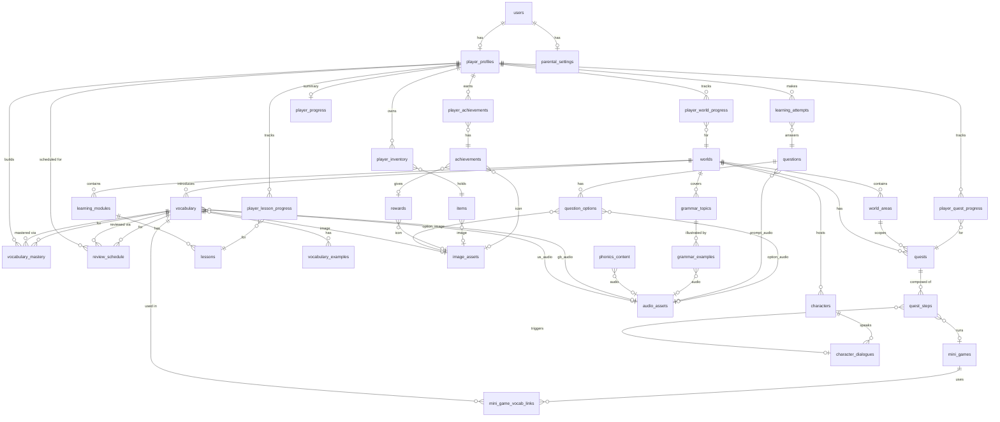

# DATABASE SCHEMA — ENGLISH ADVENTURE
> **Backend:** Supabase + PostgreSQL  
> **Engine:** Godot 4.x + GDScript  
> **Platforms:** Android · iOS · Web / Desktop  
> **Target audience:** Vietnamese-speaking children, age ~10, beginner English learners  
> **Last updated:** 2026-11-26

---

## Table of Contents

1. [Overview & Design Principles](#1-overview--design-principles)
2. [Schema Diagram (ERD)](#2-schema-diagram-erd)
3. [User Management](#3-user-management)
   - [users](#31-users)
   - [player_profiles](#32-player_profiles)
   - [parental_settings](#33-parental_settings)
4. [Game World](#4-game-world)
   - [worlds](#41-worlds)
   - [world_areas](#42-world_areas)
   - [characters](#43-characters)
   - [character_dialogues](#44-character_dialogues)
5. [Learning Content](#5-learning-content)
   - [learning_modules](#51-learning_modules)
   - [lessons](#52-lessons)
   - [vocabulary](#53-vocabulary)
   - [vocabulary_examples](#54-vocabulary_examples)
   - [phonics_content](#55-phonics_content)
   - [grammar_topics](#56-grammar_topics)
   - [grammar_examples](#57-grammar_examples)
   - [questions](#58-questions)
   - [question_options](#59-question_options)
   - [audio_assets](#510-audio_assets)
   - [image_assets](#511-image_assets)
6. [Gameplay](#6-gameplay)
   - [quests](#61-quests)
   - [quest_steps](#62-quest_steps)
   - [mini_games](#63-mini_games)
   - [mini_game_vocab_links](#64-mini_game_vocab_links)
   - [rewards](#65-rewards)
   - [items](#66-items)
   - [achievements](#67-achievements)
7. [Player Data](#7-player-data)
   - [player_progress](#71-player_progress)
   - [player_world_progress](#72-player_world_progress)
   - [player_lesson_progress](#73-player_lesson_progress)
   - [player_quest_progress](#74-player_quest_progress)
   - [learning_attempts](#75-learning_attempts)
   - [vocabulary_mastery](#76-vocabulary_mastery)
   - [review_schedule](#77-review_schedule)
   - [player_inventory](#78-player_inventory)
   - [player_achievements](#79-player_achievements)
8. [Row Level Security (RLS)](#8-row-level-security-rls)
9. [Index Recommendations](#9-index-recommendations)
10. [COPPA & Child Privacy Compliance Notes](#10-coppa--child-privacy-compliance-notes)
11. [Enum Reference](#11-enum-reference)

---

## 1. Overview & Design Principles

| Principle | Implementation |
|---|---|
| **Learning Engine independent from Adventure Engine** | `learning_modules`, `lessons`, `vocabulary`, `questions` tables are fully decoupled from quest/world tables. Mini-games reference vocab via `mini_game_vocab_links`. |
| **No content duplication** | Vocabulary rows are defined once in `vocabulary`; all mini-games, quests, and lessons reference by FK. |
| **Offline-first** | All player data tables carry `updated_at` timestamps. The Godot client maintains a local SQLite mirror; Supabase Realtime syncs on reconnect. |
| **No PII beyond player_id in event tables** | `learning_attempts` stores only `player_id` (a UUID), never name, email, or age. |
| **No hardcoded content in game logic** | All text, audio keys, and images are rows in content tables fetched at runtime. |
| **Modular architecture (17 modules)** | Each module maps to a `learning_modules` row; content is scoped by `world_id` or `module_id`. |
| **Speaking MVP** | Speaking mini-games use listen-and-repeat + self-rating. No AI grading column is stored; self-rating is captured in `learning_attempts.answer_given`. |
| **Multi-accent audio** | `audio_assets` carries an `accent` column (`en-US` / `en-GB` / `vi`). Player's preferred accent is stored in `player_profiles.audio_preference_accent`. |

---

## 2. Schema Diagram (ERD)



---

## 3. User Management

### 3.1 `users`

Extends Supabase's built-in `auth.users`. This table lives in the `public` schema as a lightweight mirror/extension point.

| Column | Type | Nullable | Default | Constraints | Notes |
|---|---|---|---|---|---|
| `id` | `uuid` | NO | — | PK, FK → `auth.users(id)` ON DELETE CASCADE | Supabase Auth UID |
| `email` | `text` | YES | — | UNIQUE | Mirrors `auth.users.email`; may be NULL for anonymous / guest accounts |
| `created_at` | `timestamptz` | NO | `now()` | — | Account creation time |
| `updated_at` | `timestamptz` | NO | `now()` | — | Updated via trigger on any field change |

> [!NOTE]
> Authentication (JWT, OAuth, magic-link) is handled entirely by Supabase Auth. The `public.users` row is auto-created by a trigger on `auth.users` INSERT. Never store passwords here.

---

### 3.2 `player_profiles`

One row per player account. Children may share a device; each user has exactly one profile.

| Column | Type | Nullable | Default | Constraints | Notes |
|---|---|---|---|---|---|
| `id` | `uuid` | NO | `gen_random_uuid()` | PK | Surrogate key |
| `user_id` | `uuid` | NO | — | UNIQUE, FK → `users(id)` ON DELETE CASCADE | 1-to-1 with users |
| `display_name` | `text` | NO | — | LENGTH 1–30, no PII | Shown in-game; not necessarily real name |
| `avatar_type` | `text` | NO | `'boy'` | CHECK IN (`boy`, `girl`) | Main character gender choice |
| `current_world_id` | `uuid` | YES | NULL | FK → `worlds(id)` | Last world the player was in |
| `player_level` | `int` | NO | `1` | CHECK ≥ 1 | Overall adventure level |
| `exp_total` | `bigint` | NO | `0` | CHECK ≥ 0 | Cumulative XP across all time |
| `exp_current_level` | `int` | NO | `0` | CHECK ≥ 0 | XP within the current level (resets on level-up) |
| `gold` | `int` | NO | `0` | CHECK ≥ 0 | In-game soft currency |
| `magic_crystals` | `int` | NO | `0` | CHECK ≥ 0 | Premium soft currency (earned, never purchased) |
| `language_preference` | `text` | NO | `'vi'` | CHECK IN (`vi`, `en`) | UI language |
| `audio_preference_accent` | `text` | NO | `'en-US'` | CHECK IN (`en-US`, `en-GB`) | Preferred English audio accent |
| `created_at` | `timestamptz` | NO | `now()` | — | |
| `updated_at` | `timestamptz` | NO | `now()` | — | Updated via trigger |

---

### 3.3 `parental_settings`

Stores parent / guardian controls for child accounts.

| Column | Type | Nullable | Default | Constraints | Notes |
|---|---|---|---|---|---|
| `id` | `uuid` | NO | `gen_random_uuid()` | PK | |
| `user_id` | `uuid` | NO | — | UNIQUE, FK → `users(id)` ON DELETE CASCADE | One per user |
| `parent_email` | `text` | YES | NULL | — | Parent / guardian email for notifications; never exposed to game client |
| `daily_play_limit_minutes` | `int` | YES | NULL | CHECK > 0 | NULL = no limit |
| `notifications_enabled` | `bool` | NO | `true` | — | Whether the parent receives progress emails |
| `created_at` | `timestamptz` | NO | `now()` | — | |

> [!CAUTION]
> `parent_email` is PII. Apply RLS so only the authenticated parent (matched via `auth.uid() = user_id`) can read or write this column. Never return it to the game client.

---

## 4. Game World

### 4.1 `worlds`

The 6 overworld islands / zones.

| Column | Type | Nullable | Default | Constraints | Notes |
|---|---|---|---|---|---|
| `id` | `uuid` | NO | `gen_random_uuid()` | PK | |
| `slug` | `text` | NO | — | UNIQUE, e.g. `alphabet_island` | URL-safe identifier used in Godot scene routing |
| `name_en` | `text` | NO | — | — | Display name in English |
| `name_vi` | `text` | NO | — | — | Display name in Vietnamese |
| `theme` | `text` | YES | NULL | — | Art / visual theme key (e.g. `fantasy_island`) |
| `order_index` | `int` | NO | — | UNIQUE | World unlock order (1 = Alphabet Island … 6 = Challenge Kingdom) |
| `is_active` | `bool` | NO | `false` | — | FALSE = not yet released; hidden from client |
| `unlock_condition_json` | `jsonb` | YES | NULL | — | e.g. `{"requires_world_slug": "alphabet_island", "min_stars": 10}` |
| `thumbnail_image` | `text` | YES | NULL | — | Asset key for map thumbnail |
| `created_at` | `timestamptz` | NO | `now()` | — | |

**Seed data (6 worlds):**

| order_index | slug | name_en |
|---|---|---|
| 1 | `alphabet_island` | Alphabet Island |
| 2 | `vocabulary_forest` | Vocabulary Forest |
| 3 | `sentence_kingdom` | Sentence Kingdom |
| 4 | `listening_ocean` | Listening Ocean |
| 5 | `speaking_city` | Speaking City |
| 6 | `challenge_kingdom` | Challenge Kingdom |

---

### 4.2 `world_areas`

Sub-zones within a world (e.g. "Beach Cove" inside Alphabet Island).

| Column | Type | Nullable | Default | Constraints | Notes |
|---|---|---|---|---|---|
| `id` | `uuid` | NO | `gen_random_uuid()` | PK | |
| `world_id` | `uuid` | NO | — | FK → `worlds(id)` ON DELETE CASCADE | Parent world |
| `name_en` | `text` | NO | — | — | |
| `name_vi` | `text` | NO | — | — | |
| `order_index` | `int` | NO | — | — | Within the world |
| `unlock_after_area_id` | `uuid` | YES | NULL | FK → `world_areas(id)` | NULL = unlocked from world start; self-referential chain |
| `visual_theme` | `text` | YES | NULL | — | Godot scene / environment key |
| `npc_ids` | `uuid[]` | YES | NULL | — | Array of `characters.id` values present in this area |

---

### 4.3 `characters`

All named characters in the game.

| Column | Type | Nullable | Default | Constraints | Notes |
|---|---|---|---|---|---|
| `id` | `uuid` | NO | `gen_random_uuid()` | PK | |
| `slug` | `text` | NO | — | UNIQUE | e.g. `buddy_dragon`, `professor_owl` |
| `name_en` | `text` | NO | — | — | |
| `name_vi` | `text` | NO | — | — | |
| `character_type` | `text` | NO | — | CHECK IN (`player`, `buddy`, `npc`, `boss`, `professor`) | |
| `world_id` | `uuid` | YES | NULL | FK → `worlds(id)` | NULL = global characters (Buddy, Prof. Owl) |
| `sprite_key` | `text` | YES | NULL | — | Godot resource path key |
| `voice_actor_note` | `text` | YES | NULL | — | Internal production note; never sent to client |
| `description_vi` | `text` | YES | NULL | — | Character description shown to player in Vietnamese |

---

### 4.4 `character_dialogues`

Dialogue lines for every character, keyed for Godot's dialogue system.

| Column | Type | Nullable | Default | Constraints | Notes |
|---|---|---|---|---|---|
| `id` | `uuid` | NO | `gen_random_uuid()` | PK | |
| `character_id` | `uuid` | NO | — | FK → `characters(id)` ON DELETE CASCADE | |
| `dialogue_key` | `text` | NO | — | — | e.g. `buddy.intro_01` |
| `text_vi` | `text` | NO | — | — | Dialogue in Vietnamese |
| `text_en` | `text` | YES | NULL | — | Optional English parallel text |
| `audio_key` | `text` | YES | NULL | — | References `audio_assets.asset_key` |
| `trigger_condition` | `text` | YES | NULL | — | e.g. `on_quest_start:quest_slug` or `on_first_visit` |
| `order_index` | `int` | NO | `0` | — | Order within a dialogue sequence |

---

## 5. Learning Content

### 5.1 `learning_modules`

Top-level groupings of lessons, one per skill focus per world.

| Column | Type | Nullable | Default | Constraints | Notes |
|---|---|---|---|---|---|
| `id` | `uuid` | NO | `gen_random_uuid()` | PK | |
| `world_id` | `uuid` | NO | — | FK → `worlds(id)` ON DELETE CASCADE | |
| `name_en` | `text` | NO | — | — | |
| `name_vi` | `text` | NO | — | — | |
| `description_vi` | `text` | YES | NULL | — | Shown in module select screen |
| `order_index` | `int` | NO | — | — | Within the world |
| `skill_focus` | `text` | NO | `'all'` | CHECK IN (`all`, `listening`, `speaking`, `reading`, `writing`) | Primary skill trained |

---

### 5.2 `lessons`

Individual lessons within a module.

| Column | Type | Nullable | Default | Constraints | Notes |
|---|---|---|---|---|---|
| `id` | `uuid` | NO | `gen_random_uuid()` | PK | |
| `module_id` | `uuid` | NO | — | FK → `learning_modules(id)` ON DELETE CASCADE | |
| `name_en` | `text` | NO | — | — | |
| `name_vi` | `text` | NO | — | — | |
| `lesson_type` | `text` | NO | — | CHECK IN (`alphabet`, `phonics`, `vocabulary`, `grammar`, `listening`, `speaking`, `reading`) | Determines which mini-game template is loaded |
| `order_index` | `int` | NO | — | — | Within the module |
| `estimated_minutes` | `int` | YES | NULL | CHECK > 0 | Approximate duration |
| `content_data_json` | `jsonb` | YES | NULL | — | Structured config: letter IDs, vocab IDs, grammar topic IDs etc. No game logic — data only |

> [!NOTE]
> `content_data_json` is a data config object, not game logic. Example for an alphabet lesson:
> ```json
> { "letters": ["A","B","C"], "focus_vocab_ids": ["uuid1","uuid2"] }
> ```

---

### 5.3 `vocabulary`

Master vocabulary table. Every word appears exactly once; all mini-games reference it by FK.

| Column | Type | Nullable | Default | Constraints | Notes |
|---|---|---|---|---|---|
| `id` | `uuid` | NO | `gen_random_uuid()` | PK | |
| `word` | `text` | NO | — | UNIQUE | Canonical English word (lowercase) |
| `phonetic_ipa` | `text` | YES | NULL | — | IPA transcription e.g. `/æpl/` |
| `meaning_vi` | `text` | NO | — | — | Primary Vietnamese translation |
| `category` | `text` | NO | — | — | e.g. `animals`, `colors`, `food` |
| `sub_category` | `text` | YES | NULL | — | e.g. `farm_animals`, `sea_animals` |
| `difficulty` | `int` | NO | `1` | CHECK BETWEEN 1 AND 5 | 1 = very easy … 5 = advanced |
| `world_id` | `uuid` | YES | NULL | FK → `worlds(id)` | Primary world where word is introduced; NULL = cross-world |
| `image_asset_id` | `uuid` | YES | NULL | FK → `image_assets(id)` | Illustration used in flash cards and word-hunt |
| `audio_us_asset_id` | `uuid` | YES | NULL | FK → `audio_assets(id)` | American English pronunciation |
| `audio_gb_asset_id` | `uuid` | YES | NULL | FK → `audio_assets(id)` | British English pronunciation |
| `example_sentence` | `text` | YES | NULL | — | Short example in English |
| `example_meaning_vi` | `text` | YES | NULL | — | Vietnamese translation of example sentence |
| `related_word_ids` | `uuid[]` | YES | NULL | — | Array of related `vocabulary.id` (synonyms, antonyms, word family) |
| `tags` | `text[]` | YES | NULL | — | e.g. `['mvp', 'alphabet_island', 'review_set_1']` |
| `review_eligible` | `bool` | NO | `true` | — | FALSE = word is excluded from spaced-repetition review queue |
| `created_at` | `timestamptz` | NO | `now()` | — | |

---

### 5.4 `vocabulary_examples`

Additional example sentences for a word (beyond the single inline example).

| Column | Type | Nullable | Default | Constraints | Notes |
|---|---|---|---|---|---|
| `id` | `uuid` | NO | `gen_random_uuid()` | PK | |
| `vocab_id` | `uuid` | NO | — | FK → `vocabulary(id)` ON DELETE CASCADE | |
| `sentence_en` | `text` | NO | — | — | Full example sentence in English |
| `sentence_meaning_vi` | `text` | NO | — | — | Vietnamese translation |
| `audio_asset_id` | `uuid` | YES | NULL | FK → `audio_assets(id)` | Audio of the sentence |
| `context_note_vi` | `text` | YES | NULL | — | Optional note explaining context, in Vietnamese |

---

### 5.5 `phonics_content`

Phoneme-level content for the Phonics / Alphabet Island lessons.

| Column | Type | Nullable | Default | Constraints | Notes |
|---|---|---|---|---|---|
| `id` | `uuid` | NO | `gen_random_uuid()` | PK | |
| `letter_id` | `uuid` | YES | NULL | FK → `vocabulary(id)` | The letter entry in vocabulary (e.g. "A") — NULL for multi-letter digraphs |
| `phoneme` | `text` | NO | — | — | e.g. `/æ/`, `/eɪ/` |
| `phoneme_description_vi` | `text` | YES | NULL | — | Vietnamese explanation of how to produce the sound |
| `audio_asset_id` | `uuid` | NO | — | FK → `audio_assets(id)` | Audio of the isolated phoneme |
| `example_word_ids` | `uuid[]` | YES | NULL | — | Array of `vocabulary.id` words illustrating this phoneme |
| `blending_group` | `text` | YES | NULL | — | e.g. `short_a`, `long_a`, `consonant_blend_bl` |
| `difficulty` | `int` | NO | `1` | CHECK BETWEEN 1 AND 5 | |

---

### 5.6 `grammar_topics`

Grammar concepts introduced per world.

| Column | Type | Nullable | Default | Constraints | Notes |
|---|---|---|---|---|---|
| `id` | `uuid` | NO | `gen_random_uuid()` | PK | |
| `world_id` | `uuid` | NO | — | FK → `worlds(id)` | |
| `topic_key` | `text` | NO | — | UNIQUE | e.g. `articles_a_an`, `simple_present` |
| `name_en` | `text` | NO | — | — | |
| `name_vi` | `text` | NO | — | — | |
| `rule_en` | `text` | YES | NULL | — | Short rule statement in English |
| `explanation_vi` | `text` | NO | — | — | Full explanation in Vietnamese |
| `difficulty` | `int` | NO | `1` | CHECK BETWEEN 1 AND 5 | |
| `order_index` | `int` | NO | — | — | Curriculum sequence within world |

---

### 5.7 `grammar_examples`

Sentence examples for a grammar topic.

| Column | Type | Nullable | Default | Constraints | Notes |
|---|---|---|---|---|---|
| `id` | `uuid` | NO | `gen_random_uuid()` | PK | |
| `grammar_topic_id` | `uuid` | NO | — | FK → `grammar_topics(id)` ON DELETE CASCADE | |
| `sentence_en` | `text` | NO | — | — | |
| `sentence_vi` | `text` | NO | — | — | Vietnamese translation |
| `highlight_parts_json` | `jsonb` | YES | NULL | — | e.g. `[{"start":2,"end":3,"color":"#FF6B35","label_vi":"mạo từ"}]` for in-game highlighting |
| `audio_asset_id` | `uuid` | YES | NULL | FK → `audio_assets(id)` | |

---

### 5.8 `questions`

Reusable question bank. Questions are assembled into mini-games at runtime.

| Column | Type | Nullable | Default | Constraints | Notes |
|---|---|---|---|---|---|
| `id` | `uuid` | NO | `gen_random_uuid()` | PK | |
| `question_type` | `text` | NO | — | CHECK IN (`multiple_choice`, `true_false`, `fill_blank`, `match_pair`, `order_words`, `listen_select`, `speak_repeat`, `image_tap`) | UI template used by mini-game |
| `skill` | `text` | NO | — | CHECK IN (`listening`, `speaking`, `reading`, `writing`) | Primary skill tested |
| `mini_game_type` | `text` | YES | NULL | — | Optional FK to game type this question belongs to (e.g. `word_hunt`) |
| `content_ref_id` | `uuid` | YES | NULL | — | UUID of the referenced content row (vocab, grammar_topic, etc.) |
| `content_ref_type` | `text` | YES | NULL | CHECK IN (`vocabulary`, `grammar_topic`, `phonics`, `lesson`, `sentence`) | Type discriminator for `content_ref_id` |
| `prompt_text` | `text` | YES | NULL | — | Question prompt text (may be NULL if audio-only prompt) |
| `prompt_audio_asset_id` | `uuid` | YES | NULL | FK → `audio_assets(id)` | Audio for the prompt |
| `correct_answer` | `text` | NO | — | — | Canonical correct answer string; also derivable from `question_options` for MCQ |
| `difficulty` | `int` | NO | `1` | CHECK BETWEEN 1 AND 5 | |
| `points_base` | `int` | NO | `10` | CHECK > 0 | Base points for a correct first-attempt answer |
| `hint_vi` | `text` | YES | NULL | — | Optional hint shown after first wrong attempt, in Vietnamese |
| `created_at` | `timestamptz` | NO | `now()` | — | |

---

### 5.9 `question_options`

Answer choices for multiple-choice, match, image-tap question types.

| Column | Type | Nullable | Default | Constraints | Notes |
|---|---|---|---|---|---|
| `id` | `uuid` | NO | `gen_random_uuid()` | PK | |
| `question_id` | `uuid` | NO | — | FK → `questions(id)` ON DELETE CASCADE | |
| `option_text` | `text` | YES | NULL | — | Text of this option (NULL for audio-only or image-only options) |
| `option_audio_asset_id` | `uuid` | YES | NULL | FK → `audio_assets(id)` | Audio option (listening questions) |
| `option_image_asset_id` | `uuid` | YES | NULL | FK → `image_assets(id)` | Image option (picture selection questions) |
| `is_correct` | `bool` | NO | `false` | — | TRUE for correct answer(s) |
| `order_index` | `int` | NO | `0` | — | Display order (can be randomized client-side) |

---

### 5.10 `audio_assets`

Registry of all audio files managed in Supabase Storage.

| Column | Type | Nullable | Default | Constraints | Notes |
|---|---|---|---|---|---|
| `id` | `uuid` | NO | `gen_random_uuid()` | PK | |
| `asset_key` | `text` | NO | — | UNIQUE | Stable key used in GDScript, e.g. `word_apple_us` |
| `file_path` | `text` | NO | — | — | Supabase Storage path, e.g. `audio/en-US/words/apple.ogg` |
| `accent` | `text` | NO | — | CHECK IN (`en-US`, `en-GB`, `vi`) | |
| `duration_seconds` | `numeric(6,2)` | YES | NULL | CHECK > 0 | Approximate playback duration |
| `content_type` | `text` | NO | — | CHECK IN (`letter_name`, `letter_sound`, `word`, `sentence`, `instruction`, `music`, `sfx`) | Categorizes the audio for filtering |
| `created_at` | `timestamptz` | NO | `now()` | — | |

---

### 5.11 `image_assets`

Registry of all image / sprite assets.

| Column | Type | Nullable | Default | Constraints | Notes |
|---|---|---|---|---|---|
| `id` | `uuid` | NO | `gen_random_uuid()` | PK | |
| `asset_key` | `text` | NO | — | UNIQUE | Stable key, e.g. `img_apple_card` |
| `file_path` | `text` | NO | — | — | Supabase Storage path, e.g. `images/vocabulary/apple.webp` |
| `width` | `int` | YES | NULL | CHECK > 0 | Pixel width |
| `height` | `int` | YES | NULL | CHECK > 0 | Pixel height |
| `content_type` | `text` | NO | — | CHECK IN (`vocabulary_card`, `avatar`, `background`, `ui_icon`, `character_sprite`, `item_icon`, `achievement_badge`) | |
| `created_at` | `timestamptz` | NO | `now()` | — | |

---

## 6. Gameplay

### 6.1 `quests`

Story quests that drive the adventure narrative. MVP: 15–20 quests in Alphabet Island.

| Column | Type | Nullable | Default | Constraints | Notes |
|---|---|---|---|---|---|
| `id` | `uuid` | NO | `gen_random_uuid()` | PK | |
| `world_id` | `uuid` | NO | — | FK → `worlds(id)` | |
| `area_id` | `uuid` | YES | NULL | FK → `world_areas(id)` | NULL = not area-specific |
| `name_en` | `text` | NO | — | — | |
| `name_vi` | `text` | NO | — | — | |
| `description_vi` | `text` | YES | NULL | — | Story context shown to player |
| `quest_type` | `text` | NO | — | CHECK IN (`main`, `side`, `daily`, `boss`) | |
| `order_index` | `int` | NO | — | — | Within the world |
| `unlock_condition_json` | `jsonb` | YES | NULL | — | e.g. `{"requires_quest_id": "uuid", "min_player_level": 3}` |
| `reward_exp` | `int` | NO | `0` | CHECK ≥ 0 | |
| `reward_gold` | `int` | NO | `0` | CHECK ≥ 0 | |
| `reward_items_json` | `jsonb` | YES | NULL | — | e.g. `[{"item_key": "buddy_hat_001", "qty": 1}]` |
| `skill_focus` | `text` | NO | `'all'` | CHECK IN (`all`, `listening`, `speaking`, `reading`, `writing`) | Primary skill trained by this quest |
| `estimated_minutes` | `int` | YES | NULL | CHECK > 0 | |

---

### 6.2 `quest_steps`

Ordered steps within a quest.

| Column | Type | Nullable | Default | Constraints | Notes |
|---|---|---|---|---|---|
| `id` | `uuid` | NO | `gen_random_uuid()` | PK | |
| `quest_id` | `uuid` | NO | — | FK → `quests(id)` ON DELETE CASCADE | |
| `step_order` | `int` | NO | — | — | Sequence within quest |
| `step_type` | `text` | NO | — | CHECK IN (`dialogue`, `mini_game`, `exploration`, `collection`) | |
| `mini_game_id` | `uuid` | YES | NULL | FK → `mini_games(id)` | Populated when `step_type = 'mini_game'` |
| `dialogue_id` | `uuid` | YES | NULL | FK → `character_dialogues(id)` | Populated when `step_type = 'dialogue'` |
| `content_ref_id` | `uuid` | YES | NULL | — | Generic content reference (e.g. item to collect) |
| `is_optional` | `bool` | NO | `false` | — | Optional steps don't block quest completion |
| `completion_condition_json` | `jsonb` | YES | NULL | — | e.g. `{"min_score_percent": 80}` or `{"collect_item_key": "magic_leaf"}` |

---

### 6.3 `mini_games`

Mini-game configuration templates. Mini-game instances are created from these configs.

| Column | Type | Nullable | Default | Constraints | Notes |
|---|---|---|---|---|---|
| `id` | `uuid` | NO | `gen_random_uuid()` | PK | |
| `game_type` | `text` | NO | — | CHECK IN (`word_hunt`, `listening_mission`, `word_builder`, `sentence_builder`, `reading_challenge`, `speaking_challenge`, `boss_battle`) | Maps to Godot scene name |
| `name_en` | `text` | NO | — | — | |
| `config_json` | `jsonb` | NO | `'{}'` | — | Game-type-specific config (question pool size, timer, item spawn rules, etc.) |
| `skill_tested` | `text` | NO | — | CHECK IN (`listening`, `speaking`, `reading`, `writing`) | |
| `difficulty_base` | `int` | NO | `1` | CHECK BETWEEN 1 AND 5 | |
| `time_limit_seconds` | `int` | YES | NULL | CHECK > 0 | NULL = untimed |
| `lives_count` | `int` | NO | `3` | CHECK > 0 | |
| `pass_threshold_percent` | `int` | NO | `70` | CHECK BETWEEN 1 AND 100 | Minimum score % to pass |

**MVP mini-games:**

| game_type | Skill | Description |
|---|---|---|
| `word_hunt` | Reading | Find hidden words in a 3D scene |
| `listening_mission` | Listening | Hear audio → select correct word/image |
| `word_builder` | Writing | Arrange letter tiles to spell a word |
| `sentence_builder` | Writing/Reading | Drag word cards into correct order |
| `reading_challenge` | Reading | Read short passage → answer questions |
| `speaking_challenge` | Speaking | Listen → repeat → self-rate (MVP: no AI) |
| `boss_battle` | All | Mixed rapid-fire questions to defeat boss |

---

### 6.4 `mini_game_vocab_links`

Many-to-many join: which vocabulary words are used in which mini-game.

| Column | Type | Nullable | Default | Constraints | Notes |
|---|---|---|---|---|---|
| `mini_game_id` | `uuid` | NO | — | PK (composite), FK → `mini_games(id)` ON DELETE CASCADE | |
| `vocab_id` | `uuid` | NO | — | PK (composite), FK → `vocabulary(id)` ON DELETE CASCADE | |

> [!TIP]
> This join table is the key mechanism that lets vocabulary be reused across mini-games without duplication. Query it with `mini_game_id` to fetch all words for a game session, or with `vocab_id` to find all games that feature a word.

---

### 6.5 `rewards`

Reward definitions referenced by quests, achievements, and level-ups.

| Column | Type | Nullable | Default | Constraints | Notes |
|---|---|---|---|---|---|
| `id` | `uuid` | NO | `gen_random_uuid()` | PK | |
| `reward_type` | `text` | NO | — | CHECK IN (`exp`, `gold`, `item`, `crystal`, `achievement`) | |
| `reward_key` | `text` | NO | — | UNIQUE | e.g. `quest_complete_basic_exp` |
| `name_vi` | `text` | NO | — | — | Display name in Vietnamese |
| `amount` | `int` | YES | NULL | CHECK > 0 | Amount of EXP / gold / crystals (NULL for item rewards) |
| `icon_asset_id` | `uuid` | YES | NULL | FK → `image_assets(id)` | |

---

### 6.6 `items`

Collectible items: avatar accessories, Buddy skins, badges.

| Column | Type | Nullable | Default | Constraints | Notes |
|---|---|---|---|---|---|
| `id` | `uuid` | NO | `gen_random_uuid()` | PK | |
| `item_key` | `text` | NO | — | UNIQUE | e.g. `buddy_hat_wizard` |
| `name_vi` | `text` | NO | — | — | |
| `description_vi` | `text` | YES | NULL | — | Flavour text |
| `item_type` | `text` | NO | — | CHECK IN (`avatar_accessory`, `buddy_skin`, `magic_crystal`, `badge`) | |
| `rarity` | `text` | NO | `'common'` | CHECK IN (`common`, `rare`, `epic`, `legendary`) | |
| `image_asset_id` | `uuid` | NO | — | FK → `image_assets(id)` | |

---

### 6.7 `achievements`

Milestone achievements (badges, trophies).

| Column | Type | Nullable | Default | Constraints | Notes |
|---|---|---|---|---|---|
| `id` | `uuid` | NO | `gen_random_uuid()` | PK | |
| `achievement_key` | `text` | NO | — | UNIQUE | e.g. `mastered_all_26_letters` |
| `name_vi` | `text` | NO | — | — | |
| `description_vi` | `text` | NO | — | — | |
| `condition_json` | `jsonb` | NO | — | — | e.g. `{"type": "vocab_mastered_count", "threshold": 26}` |
| `reward_id` | `uuid` | YES | NULL | FK → `rewards(id)` | Optional reward on first earn |
| `icon_asset_id` | `uuid` | NO | — | FK → `image_assets(id)` | |
| `is_secret` | `bool` | NO | `false` | — | Secret achievements are hidden until earned |

---

## 7. Player Data

### 7.1 `player_progress`

Aggregate summary stats per player (denormalized for quick dashboard reads).

| Column | Type | Nullable | Default | Constraints | Notes |
|---|---|---|---|---|---|
| `id` | `uuid` | NO | `gen_random_uuid()` | PK | |
| `player_id` | `uuid` | NO | — | UNIQUE, FK → `player_profiles(id)` ON DELETE CASCADE | |
| `total_quests_completed` | `int` | NO | `0` | CHECK ≥ 0 | |
| `total_vocab_mastered` | `int` | NO | `0` | CHECK ≥ 0 | Words at mastery_level = 5 |
| `total_exp` | `bigint` | NO | `0` | CHECK ≥ 0 | Mirrors `player_profiles.exp_total` (kept for analytics) |
| `highest_world_id` | `uuid` | YES | NULL | FK → `worlds(id)` | Furthest world reached |
| `streak_days` | `int` | NO | `0` | CHECK ≥ 0 | Consecutive days played |
| `last_played_at` | `timestamptz` | YES | NULL | — | |
| `updated_at` | `timestamptz` | NO | `now()` | — | |

---

### 7.2 `player_world_progress`

Per-player, per-world unlock & completion state.

| Column | Type | Nullable | Default | Constraints | Notes |
|---|---|---|---|---|---|
| `player_id` | `uuid` | NO | — | PK (composite), FK → `player_profiles(id)` ON DELETE CASCADE | |
| `world_id` | `uuid` | NO | — | PK (composite), FK → `worlds(id)` ON DELETE CASCADE | |
| `is_unlocked` | `bool` | NO | `false` | — | |
| `is_completed` | `bool` | NO | `false` | — | |
| `stars_earned` | `int` | NO | `0` | CHECK BETWEEN 0 AND 3 | Star rating for the world |
| `completion_percent` | `numeric(5,2)` | NO | `0.00` | CHECK BETWEEN 0 AND 100 | % of quests / lessons completed |
| `first_completed_at` | `timestamptz` | YES | NULL | — | |

---

### 7.3 `player_lesson_progress`

Per-player, per-lesson attempt tracking.

| Column | Type | Nullable | Default | Constraints | Notes |
|---|---|---|---|---|---|
| `id` | `uuid` | NO | `gen_random_uuid()` | PK | |
| `player_id` | `uuid` | NO | — | FK → `player_profiles(id)` ON DELETE CASCADE | |
| `lesson_id` | `uuid` | NO | — | FK → `lessons(id)` ON DELETE CASCADE | |
| `attempts` | `int` | NO | `0` | CHECK ≥ 0 | Total number of attempts |
| `best_score` | `int` | NO | `0` | CHECK ≥ 0 | Best score achieved (points) |
| `is_completed` | `bool` | NO | `false` | — | |
| `completed_at` | `timestamptz` | YES | NULL | — | Timestamp of first completion |

**Unique constraint:** `(player_id, lesson_id)`

---

### 7.4 `player_quest_progress`

Per-player, per-quest status and performance.

| Column | Type | Nullable | Default | Constraints | Notes |
|---|---|---|---|---|---|
| `id` | `uuid` | NO | `gen_random_uuid()` | PK | |
| `player_id` | `uuid` | NO | — | FK → `player_profiles(id)` ON DELETE CASCADE | |
| `quest_id` | `uuid` | NO | — | FK → `quests(id)` ON DELETE CASCADE | |
| `status` | `text` | NO | `'locked'` | CHECK IN (`locked`, `available`, `in_progress`, `completed`) | |
| `stars_earned` | `int` | NO | `0` | CHECK BETWEEN 0 AND 3 | 3 stars = perfect score |
| `started_at` | `timestamptz` | YES | NULL | — | |
| `completed_at` | `timestamptz` | YES | NULL | — | |
| `attempt_count` | `int` | NO | `0` | CHECK ≥ 0 | |

**Unique constraint:** `(player_id, quest_id)`

---

### 7.5 `learning_attempts`

Immutable event log of every answer submitted. Used for analytics and adaptive difficulty.

| Column | Type | Nullable | Default | Constraints | Notes |
|---|---|---|---|---|---|
| `id` | `uuid` | NO | `gen_random_uuid()` | PK | |
| `player_id` | `uuid` | NO | — | FK → `player_profiles(id)` ON DELETE CASCADE | No name, DOB, or device ID stored |
| `question_id` | `uuid` | NO | — | FK → `questions(id)` ON DELETE CASCADE | |
| `session_id` | `uuid` | NO | — | — | Groups attempts within one play session (client-generated UUID) |
| `answer_given` | `text` | YES | NULL | — | The player's raw answer; for speaking = self-rating string (`good`/`ok`/`again`) |
| `is_correct` | `bool` | NO | — | — | |
| `response_time_ms` | `int` | YES | NULL | CHECK > 0 | Time from question display to answer submission |
| `created_at` | `timestamptz` | NO | `now()` | — | Insert-only; never updated |

> [!IMPORTANT]
> `learning_attempts` is an **append-only** table. Never UPDATE or DELETE rows — it is the source of truth for learning analytics. Add a Supabase DB policy or trigger that blocks UPDATE/DELETE from the application role.

---

### 7.6 `vocabulary_mastery`

Spaced-repetition state per player per word (SM-2 / SM-2-inspired algorithm).

| Column | Type | Nullable | Default | Constraints | Notes |
|---|---|---|---|---|---|
| `player_id` | `uuid` | NO | — | PK (composite), FK → `player_profiles(id)` ON DELETE CASCADE | |
| `vocab_id` | `uuid` | NO | — | PK (composite), FK → `vocabulary(id)` ON DELETE CASCADE | |
| `mastery_level` | `int` | NO | `0` | CHECK BETWEEN 0 AND 5 | 0 = unseen, 5 = mastered |
| `ease_factor` | `numeric(4,2)` | NO | `2.50` | CHECK ≥ 1.30 | SM-2 ease factor (EF); default 2.5 |
| `interval_days` | `int` | NO | `1` | CHECK ≥ 1 | Days until next review |
| `repetitions` | `int` | NO | `0` | CHECK ≥ 0 | Consecutive successful reviews |
| `next_review_at` | `timestamptz` | YES | NULL | — | NULL = not yet scheduled |
| `last_reviewed_at` | `timestamptz` | YES | NULL | — | |

> [!NOTE]
> The SM-2 algorithm runs client-side in GDScript and writes the updated state back to this table. The server does not compute EF updates — this keeps the architecture offline-first compatible.

---

### 7.7 `review_schedule`

Scheduled spaced-repetition review sessions (each row = one word review event).

| Column | Type | Nullable | Default | Constraints | Notes |
|---|---|---|---|---|---|
| `id` | `uuid` | NO | `gen_random_uuid()` | PK | |
| `player_id` | `uuid` | NO | — | FK → `player_profiles(id)` ON DELETE CASCADE | |
| `vocab_id` | `uuid` | NO | — | FK → `vocabulary(id)` ON DELETE CASCADE | |
| `scheduled_at` | `timestamptz` | NO | — | — | When this review is due |
| `completed_at` | `timestamptz` | YES | NULL | — | NULL = not yet reviewed |
| `result` | `text` | YES | NULL | CHECK IN (`again`, `hard`, `good`, `easy`) | Anki-style rating; NULL until completed |

---

### 7.8 `player_inventory`

Items owned by a player.

| Column | Type | Nullable | Default | Constraints | Notes |
|---|---|---|---|---|---|
| `player_id` | `uuid` | NO | — | PK (composite), FK → `player_profiles(id)` ON DELETE CASCADE | |
| `item_id` | `uuid` | NO | — | PK (composite), FK → `items(id)` ON DELETE CASCADE | |
| `quantity` | `int` | NO | `1` | CHECK ≥ 1 | |
| `acquired_at` | `timestamptz` | NO | `now()` | — | First acquisition timestamp |

---

### 7.9 `player_achievements`

Achievements earned by a player.

| Column | Type | Nullable | Default | Constraints | Notes |
|---|---|---|---|---|---|
| `player_id` | `uuid` | NO | — | PK (composite), FK → `player_profiles(id)` ON DELETE CASCADE | |
| `achievement_id` | `uuid` | NO | — | PK (composite), FK → `achievements(id)` ON DELETE CASCADE | |
| `earned_at` | `timestamptz` | NO | `now()` | — | |

---

## 8. Row Level Security (RLS)

All tables have RLS enabled. Below are the key policies.

```sql
-- ============================================================
-- Enable RLS on all player-data tables
-- ============================================================
ALTER TABLE public.player_profiles         ENABLE ROW LEVEL SECURITY;
ALTER TABLE public.parental_settings       ENABLE ROW LEVEL SECURITY;
ALTER TABLE public.player_progress         ENABLE ROW LEVEL SECURITY;
ALTER TABLE public.player_world_progress   ENABLE ROW LEVEL SECURITY;
ALTER TABLE public.player_lesson_progress  ENABLE ROW LEVEL SECURITY;
ALTER TABLE public.player_quest_progress   ENABLE ROW LEVEL SECURITY;
ALTER TABLE public.learning_attempts       ENABLE ROW LEVEL SECURITY;
ALTER TABLE public.vocabulary_mastery      ENABLE ROW LEVEL SECURITY;
ALTER TABLE public.review_schedule         ENABLE ROW LEVEL SECURITY;
ALTER TABLE public.player_inventory        ENABLE ROW LEVEL SECURITY;
ALTER TABLE public.player_achievements     ENABLE ROW LEVEL SECURITY;

-- Content tables are read-only public (no PII)
ALTER TABLE public.worlds                  ENABLE ROW LEVEL SECURITY;
ALTER TABLE public.vocabulary              ENABLE ROW LEVEL SECURITY;
ALTER TABLE public.questions               ENABLE ROW LEVEL SECURITY;
ALTER TABLE public.mini_games              ENABLE ROW LEVEL SECURITY;

-- ============================================================
-- player_profiles: each user can only read/write their own row
-- ============================================================
CREATE POLICY "player_profiles_self_select"
  ON public.player_profiles
  FOR SELECT
  USING (user_id = auth.uid());

CREATE POLICY "player_profiles_self_update"
  ON public.player_profiles
  FOR UPDATE
  USING (user_id = auth.uid());

CREATE POLICY "player_profiles_self_insert"
  ON public.player_profiles
  FOR INSERT
  WITH CHECK (user_id = auth.uid());

-- ============================================================
-- parental_settings: user can only manage their own settings
-- ============================================================
CREATE POLICY "parental_settings_owner_all"
  ON public.parental_settings
  FOR ALL
  USING (user_id = auth.uid())
  WITH CHECK (user_id = auth.uid());

-- ============================================================
-- player_world_progress: player sees only their own rows
-- ============================================================
CREATE POLICY "world_progress_owner"
  ON public.player_world_progress
  FOR ALL
  USING (
    player_id IN (
      SELECT id FROM public.player_profiles WHERE user_id = auth.uid()
    )
  );

-- ============================================================
-- learning_attempts: player can INSERT and SELECT own rows only
--                    UPDATE and DELETE are blocked for all roles
-- ============================================================
CREATE POLICY "attempts_owner_select"
  ON public.learning_attempts
  FOR SELECT
  USING (
    player_id IN (
      SELECT id FROM public.player_profiles WHERE user_id = auth.uid()
    )
  );

CREATE POLICY "attempts_owner_insert"
  ON public.learning_attempts
  FOR INSERT
  WITH CHECK (
    player_id IN (
      SELECT id FROM public.player_profiles WHERE user_id = auth.uid()
    )
  );

-- No UPDATE / DELETE policy → blocked by default

-- ============================================================
-- vocabulary_mastery: player reads/writes their own SRS state
-- ============================================================
CREATE POLICY "mastery_owner_all"
  ON public.vocabulary_mastery
  FOR ALL
  USING (
    player_id IN (
      SELECT id FROM public.player_profiles WHERE user_id = auth.uid()
    )
  );

-- ============================================================
-- Content tables (worlds, vocabulary, questions, mini_games):
-- Authenticated users can SELECT; only service_role can write
-- ============================================================
CREATE POLICY "content_authenticated_read"
  ON public.worlds
  FOR SELECT
  TO authenticated
  USING (is_active = true);

CREATE POLICY "vocab_authenticated_read"
  ON public.vocabulary
  FOR SELECT
  TO authenticated
  USING (true);

CREATE POLICY "questions_authenticated_read"
  ON public.questions
  FOR SELECT
  TO authenticated
  USING (true);

CREATE POLICY "mini_games_authenticated_read"
  ON public.mini_games
  FOR SELECT
  TO authenticated
  USING (true);
```

---

## 9. Index Recommendations

```sql
-- ============================================================
-- User & Profile lookups
-- ============================================================
CREATE INDEX idx_player_profiles_user_id
  ON public.player_profiles (user_id);

CREATE INDEX idx_parental_settings_user_id
  ON public.parental_settings (user_id);

-- ============================================================
-- World & Content hierarchy
-- ============================================================
CREATE INDEX idx_world_areas_world_id
  ON public.world_areas (world_id);

CREATE INDEX idx_worlds_order_index
  ON public.worlds (order_index) WHERE is_active = true;

CREATE INDEX idx_vocabulary_world_id
  ON public.vocabulary (world_id);

CREATE INDEX idx_vocabulary_category
  ON public.vocabulary (category);

CREATE INDEX idx_vocabulary_difficulty
  ON public.vocabulary (difficulty);

CREATE INDEX idx_vocabulary_tags
  ON public.vocabulary USING GIN (tags);

CREATE INDEX idx_learning_modules_world_id
  ON public.learning_modules (world_id);

CREATE INDEX idx_lessons_module_id
  ON public.lessons (module_id);

CREATE INDEX idx_quests_world_id
  ON public.quests (world_id);

CREATE INDEX idx_quest_steps_quest_id
  ON public.quest_steps (quest_id);

CREATE INDEX idx_questions_skill
  ON public.questions (skill);

CREATE INDEX idx_questions_question_type
  ON public.questions (question_type);

CREATE INDEX idx_questions_difficulty
  ON public.questions (difficulty);

CREATE INDEX idx_questions_content_ref
  ON public.questions (content_ref_type, content_ref_id);

CREATE INDEX idx_question_options_question_id
  ON public.question_options (question_id);

CREATE INDEX idx_mini_game_vocab_links_vocab_id
  ON public.mini_game_vocab_links (vocab_id);

CREATE INDEX idx_audio_assets_asset_key
  ON public.audio_assets (asset_key);

CREATE INDEX idx_audio_assets_accent
  ON public.audio_assets (accent);

CREATE INDEX idx_image_assets_asset_key
  ON public.image_assets (asset_key);

-- ============================================================
-- Player progress lookups (most frequent game reads)
-- ============================================================
CREATE INDEX idx_player_world_progress_player_id
  ON public.player_world_progress (player_id);

CREATE INDEX idx_player_quest_progress_player_id
  ON public.player_quest_progress (player_id);

CREATE INDEX idx_player_quest_progress_status
  ON public.player_quest_progress (player_id, status);

CREATE INDEX idx_player_lesson_progress_player_id
  ON public.player_lesson_progress (player_id);

-- ============================================================
-- Spaced repetition (time-sensitive query)
-- ============================================================
CREATE INDEX idx_vocabulary_mastery_player_next_review
  ON public.vocabulary_mastery (player_id, next_review_at)
  WHERE next_review_at IS NOT NULL;

CREATE INDEX idx_review_schedule_player_due
  ON public.review_schedule (player_id, scheduled_at)
  WHERE completed_at IS NULL;

-- ============================================================
-- Analytics & attempt history
-- ============================================================
CREATE INDEX idx_learning_attempts_player_id
  ON public.learning_attempts (player_id);

CREATE INDEX idx_learning_attempts_session_id
  ON public.learning_attempts (session_id);

CREATE INDEX idx_learning_attempts_created_at
  ON public.learning_attempts (created_at DESC);

CREATE INDEX idx_learning_attempts_question_correct
  ON public.learning_attempts (question_id, is_correct);

-- ============================================================
-- Inventory & achievements
-- ============================================================
CREATE INDEX idx_player_inventory_player_id
  ON public.player_inventory (player_id);

CREATE INDEX idx_player_achievements_player_id
  ON public.player_achievements (player_id);
```

---

## 10. COPPA & Child Privacy Compliance Notes

> [!IMPORTANT]
> English Adventure targets children ~age 10. The following measures address **COPPA** (US), **GDPR-K** (EU), and general child-safety best practices.

### 10.1 Data Minimization

| Rule | Implementation |
|---|---|
| No real name collected | `display_name` is a chosen in-game nickname, not a real name. |
| No date of birth stored | Age gate (if required) is handled client-side only; no DOB persisted. |
| No device identifiers stored | `learning_attempts` contains only `player_id` (a UUID) and `session_id` (ephemeral UUID). |
| No precise geolocation | Location is never requested or stored. |
| No third-party ad SDKs | No advertising data columns exist in schema. |

### 10.2 Parental Consent & Controls

| Feature | Implementation |
|---|---|
| Parental email | Stored only in `parental_settings.parent_email`; protected by RLS (owner-only). Never returned to game client. |
| Play time limits | `parental_settings.daily_play_limit_minutes` enforced client-side; server records `last_played_at` for parental dashboard. |
| Data deletion | Deleting `users.id` cascades to `player_profiles` and all child tables via `ON DELETE CASCADE`. Full erasure in one statement. |
| Notifications opt-out | `parental_settings.notifications_enabled = false` suppresses all outbound emails. |

### 10.3 Data Retention

```sql
-- Example: auto-purge learning_attempts older than 365 days
-- (Schedule via Supabase pg_cron extension)
SELECT cron.schedule(
  'purge_old_attempts',
  '0 3 * * *',   -- 3 AM daily
  $$
    DELETE FROM public.learning_attempts
    WHERE created_at < now() - INTERVAL '365 days';
  $$
);
```

### 10.4 Security Posture

| Control | Detail |
|---|---|
| **RLS on all tables** | No table is globally readable/writable without authentication and an explicit policy. |
| **Service role key never in client** | Godot client uses the `anon` / `authenticated` Supabase key only. Content writes (new vocab, assets) go through a backend Edge Function or admin dashboard using the service role key stored server-side. |
| **Append-only event log** | `learning_attempts` has no UPDATE/DELETE RLS policy, making it tamper-evident. |
| **No PII in analytics** | Analytics queries aggregate by `player_id` (UUID). No name or email is ever joined into analytics exports. |
| **Encrypted at rest** | Supabase encrypts all PostgreSQL data at rest by default. |
| **TLS in transit** | All Supabase connections enforce TLS 1.2+. |

---

## 11. Enum Reference

The schema uses `text` columns with `CHECK` constraints rather than PostgreSQL `ENUM` types, so values can be extended without a schema migration.

| Column | Valid Values |
|---|---|
| `player_profiles.avatar_type` | `boy`, `girl` |
| `player_profiles.audio_preference_accent` | `en-US`, `en-GB` |
| `player_profiles.language_preference` | `vi`, `en` |
| `characters.character_type` | `player`, `buddy`, `npc`, `boss`, `professor` |
| `learning_modules.skill_focus` | `all`, `listening`, `speaking`, `reading`, `writing` |
| `lessons.lesson_type` | `alphabet`, `phonics`, `vocabulary`, `grammar`, `listening`, `speaking`, `reading` |
| `questions.question_type` | `multiple_choice`, `true_false`, `fill_blank`, `match_pair`, `order_words`, `listen_select`, `speak_repeat`, `image_tap` |
| `questions.skill` | `listening`, `speaking`, `reading`, `writing` |
| `questions.content_ref_type` | `vocabulary`, `grammar_topic`, `phonics`, `lesson`, `sentence` |
| `audio_assets.accent` | `en-US`, `en-GB`, `vi` |
| `audio_assets.content_type` | `letter_name`, `letter_sound`, `word`, `sentence`, `instruction`, `music`, `sfx` |
| `image_assets.content_type` | `vocabulary_card`, `avatar`, `background`, `ui_icon`, `character_sprite`, `item_icon`, `achievement_badge` |
| `quests.quest_type` | `main`, `side`, `daily`, `boss` |
| `quests.skill_focus` | `all`, `listening`, `speaking`, `reading`, `writing` |
| `quest_steps.step_type` | `dialogue`, `mini_game`, `exploration`, `collection` |
| `mini_games.game_type` | `word_hunt`, `listening_mission`, `word_builder`, `sentence_builder`, `reading_challenge`, `speaking_challenge`, `boss_battle` |
| `mini_games.skill_tested` | `listening`, `speaking`, `reading`, `writing` |
| `rewards.reward_type` | `exp`, `gold`, `item`, `crystal`, `achievement` |
| `items.item_type` | `avatar_accessory`, `buddy_skin`, `magic_crystal`, `badge` |
| `items.rarity` | `common`, `rare`, `epic`, `legendary` |
| `player_quest_progress.status` | `locked`, `available`, `in_progress`, `completed` |
| `review_schedule.result` | `again`, `hard`, `good`, `easy` |

---

*Document generated for English Adventure MVP · Supabase + PostgreSQL · Godot 4.x*
