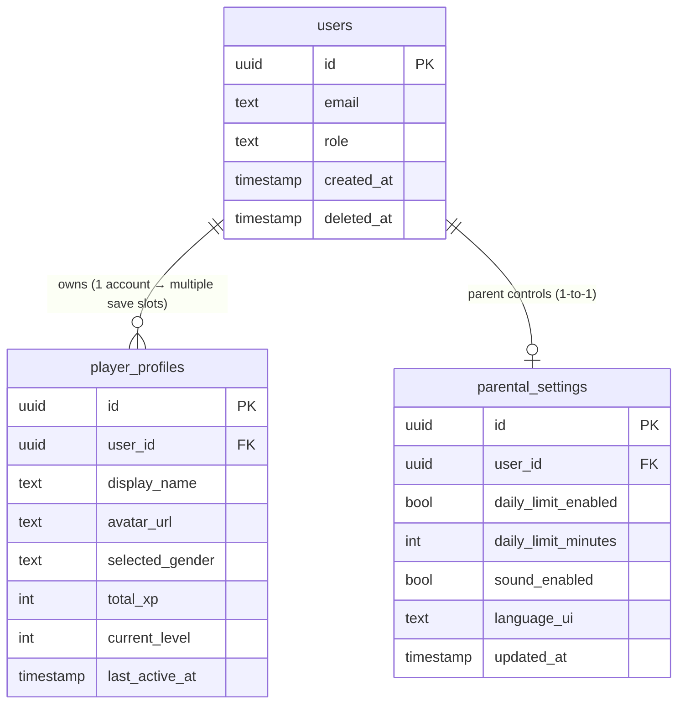
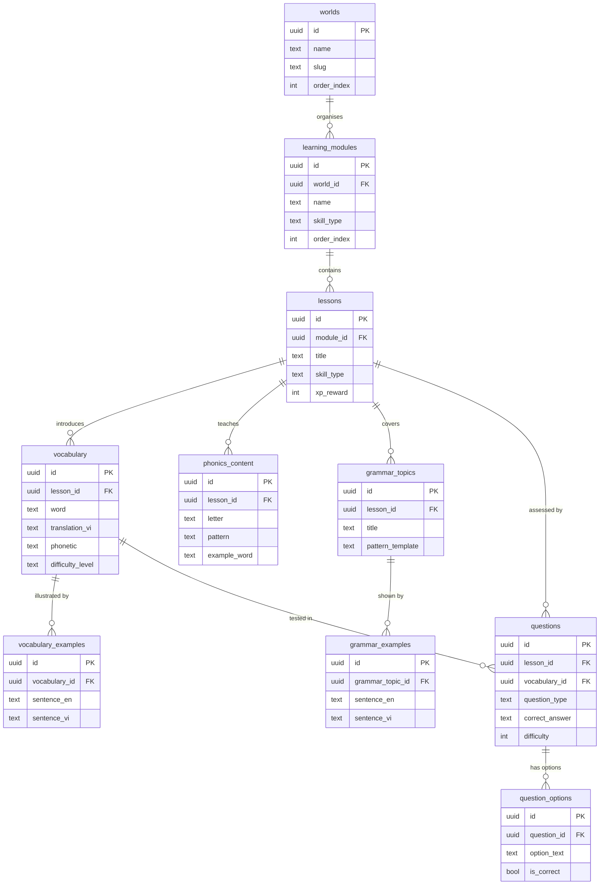
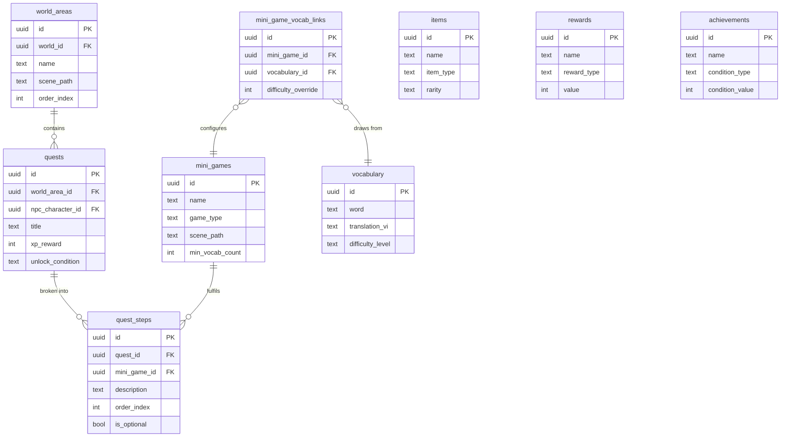

# Entity-Relationship Diagram — ENGLISH ADVENTURE

> **Engine:** Godot 4.x + GDScript | **Backend:** Supabase + PostgreSQL  
> **Platforms:** Android, iOS, Web/Desktop | **Target:** Vietnamese-speaking children, age 10

---

## 1. Overview

The data model is designed around two independent engines working in concert:

- **Learning Engine** — owns vocabulary, phonics, grammar, lessons, questions, SRS mastery, and attempt analytics. It has no knowledge of quests or mini-game implementations.
- **Adventure Engine** — owns worlds, areas, quests, mini-games, characters, rewards, and inventory. It references learning content through explicit link tables rather than embedding it.

### Design Philosophy

| Principle | Implementation |
|---|---|
| **Content reuse** | `vocabulary` rows are shared across every mini-game via `mini_game_vocab_links` — no duplication |
| **Offline-first** | Progress tables store local state; `synced_at` timestamps drive delta sync |
| **No hardcoded content** | All learning content lives in DB rows, never in game scripts |
| **SRS per learner** | `vocabulary_mastery` and `review_schedule` are per-player, independent of game session |
| **Privacy by design** | `learning_attempts` stores aggregate signals, not raw keystroke or voice data |
| **UUID everywhere** | All PKs are UUIDs to support distributed offline creation and future federation |
| **Soft deletes** | Active content uses `is_active` / `deleted_at`; hard-delete only on purge |

---

## 2. Full ERD

```mermaid
erDiagram

    %% ── USER & PROFILE ──────────────────────────────────────────────
    users {
        uuid id PK
        text email
        text password_hash
        text role
        timestamp created_at
        timestamp deleted_at
    }

    player_profiles {
        uuid id PK
        uuid user_id FK
        text display_name
        text avatar_url
        text selected_gender
        int total_xp
        int current_level
        text current_world_id
        timestamp last_active_at
        timestamp created_at
    }

    parental_settings {
        uuid id PK
        uuid user_id FK
        bool daily_limit_enabled
        int daily_limit_minutes
        bool sound_enabled
        bool notifications_enabled
        text language_ui
        timestamp updated_at
    }

    users ||--o{ player_profiles : "has"
    users ||--o| parental_settings : "configures"

    %% ── WORLD & AREA ─────────────────────────────────────────────────
    worlds {
        uuid id PK
        text name
        text slug
        text description
        int order_index
        text theme
        text unlock_condition
        bool is_active
    }

    world_areas {
        uuid id PK
        uuid world_id FK
        text name
        text description
        int order_index
        text scene_path
        bool is_active
    }

    worlds ||--o{ world_areas : "contains"

    %% ── CHARACTERS ───────────────────────────────────────────────────
    characters {
        uuid id PK
        text name
        text role
        text description
        text sprite_path
        text voice_pack_id
        bool is_npc
    }

    character_dialogues {
        uuid id PK
        uuid character_id FK
        uuid world_area_id FK
        text trigger_condition
        text dialogue_text
        text audio_asset_id
        int order_index
    }

    characters ||--o{ character_dialogues : "speaks"
    world_areas ||--o{ character_dialogues : "hosts"

    %% ── LEARNING CONTENT ─────────────────────────────────────────────
    learning_modules {
        uuid id PK
        uuid world_id FK
        text name
        text skill_type
        int order_index
        bool is_active
    }

    lessons {
        uuid id PK
        uuid module_id FK
        text title
        text description
        text skill_type
        int order_index
        int xp_reward
        bool is_active
    }

    vocabulary {
        uuid id PK
        uuid lesson_id FK
        text word
        text translation_vi
        text phonetic
        text part_of_speech
        text difficulty_level
        text audio_asset_id
        text image_asset_id
        int cefr_level
        bool is_active
    }

    vocabulary_examples {
        uuid id PK
        uuid vocabulary_id FK
        text sentence_en
        text sentence_vi
        text audio_asset_id
    }

    phonics_content {
        uuid id PK
        uuid lesson_id FK
        text letter
        text sound_symbol
        text pattern
        text example_word
        text audio_asset_id
        text image_asset_id
        int order_index
    }

    grammar_topics {
        uuid id PK
        uuid lesson_id FK
        text title
        text explanation_en
        text explanation_vi
        text pattern_template
        int order_index
    }

    grammar_examples {
        uuid id PK
        uuid grammar_topic_id FK
        text sentence_en
        text sentence_vi
        text audio_asset_id
    }

    questions {
        uuid id PK
        uuid lesson_id FK
        uuid vocabulary_id FK
        text question_type
        text prompt_text
        text prompt_audio_id
        text correct_answer
        int difficulty
        bool is_active
    }

    question_options {
        uuid id PK
        uuid question_id FK
        text option_text
        text option_audio_id
        bool is_correct
        int order_index
    }

    audio_assets {
        uuid id PK
        text file_path
        text language_code
        text asset_type
        int duration_ms
        timestamp created_at
    }

    image_assets {
        uuid id PK
        text file_path
        text asset_type
        int width_px
        int height_px
        timestamp created_at
    }

    worlds ||--o{ learning_modules : "organises"
    learning_modules ||--o{ lessons : "contains"
    lessons ||--o{ vocabulary : "introduces"
    lessons ||--o{ phonics_content : "teaches"
    lessons ||--o{ grammar_topics : "covers"
    lessons ||--o{ questions : "assessed by"
    vocabulary ||--o{ vocabulary_examples : "illustrated by"
    grammar_topics ||--o{ grammar_examples : "shown by"
    questions ||--o{ question_options : "has"

    %% ── GAMEPLAY STRUCTURE ───────────────────────────────────────────
    quests {
        uuid id PK
        uuid world_area_id FK
        uuid npc_character_id FK
        text title
        text description
        int order_index
        int xp_reward
        text unlock_condition
        bool is_active
    }

    quest_steps {
        uuid id PK
        uuid quest_id FK
        uuid mini_game_id FK
        text description
        int order_index
        bool is_optional
    }

    mini_games {
        uuid id PK
        text name
        text game_type
        text description
        text scene_path
        int min_vocab_count
        bool is_active
    }

    mini_game_vocab_links {
        uuid id PK
        uuid mini_game_id FK
        uuid vocabulary_id FK
        int difficulty_override
        bool is_active
    }

    rewards {
        uuid id PK
        text name
        text reward_type
        text description
        text icon_asset_id
        int value
    }

    items {
        uuid id PK
        text name
        text item_type
        text description
        text icon_asset_id
        text rarity
        bool is_active
    }

    achievements {
        uuid id PK
        text name
        text description
        text icon_asset_id
        text condition_type
        int condition_value
        bool is_active
    }

    world_areas ||--o{ quests : "contains"
    characters ||--o{ quests : "gives"
    quests ||--o{ quest_steps : "broken into"
    mini_games ||--o{ quest_steps : "used by"
    mini_games }o--o{ vocabulary : "draws from"
    mini_game_vocab_links }o--|| mini_games : "links"
    mini_game_vocab_links }o--|| vocabulary : "links"

    %% ── PLAYER PROGRESS & MASTERY ────────────────────────────────────
    player_progress {
        uuid id PK
        uuid player_id FK
        int total_xp
        int current_level
        int streak_days
        date last_played_date
        timestamp synced_at
    }

    player_world_progress {
        uuid id PK
        uuid player_id FK
        uuid world_id FK
        text status
        int completion_pct
        timestamp unlocked_at
        timestamp completed_at
    }

    player_lesson_progress {
        uuid id PK
        uuid player_id FK
        uuid lesson_id FK
        text status
        int score_best
        int attempts_count
        timestamp completed_at
        timestamp synced_at
    }

    player_quest_progress {
        uuid id PK
        uuid player_id FK
        uuid quest_id FK
        text status
        int current_step_index
        timestamp started_at
        timestamp completed_at
        timestamp synced_at
    }

    learning_attempts {
        uuid id PK
        uuid player_id FK
        uuid question_id FK
        uuid session_id
        bool is_correct
        int response_time_ms
        int attempt_number
        timestamp attempted_at
    }

    vocabulary_mastery {
        uuid id PK
        uuid player_id FK
        uuid vocabulary_id FK
        int mastery_level
        int correct_streak
        int total_seen
        int total_correct
        float ease_factor
        timestamp last_reviewed_at
        timestamp synced_at
    }

    review_schedule {
        uuid id PK
        uuid player_id FK
        uuid vocabulary_id FK
        date next_review_date
        int interval_days
        text srs_stage
        timestamp updated_at
    }

    player_inventory {
        uuid id PK
        uuid player_id FK
        uuid item_id FK
        int quantity
        bool is_equipped
        timestamp acquired_at
    }

    player_achievements {
        uuid id PK
        uuid player_id FK
        uuid achievement_id FK
        timestamp unlocked_at
        bool is_notified
    }

    player_profiles ||--o{ player_progress : "tracks"
    player_profiles ||--o{ player_world_progress : "records"
    player_profiles ||--o{ player_lesson_progress : "records"
    player_profiles ||--o{ player_quest_progress : "records"
    player_profiles ||--o{ learning_attempts : "generates"
    player_profiles ||--o{ vocabulary_mastery : "builds"
    player_profiles ||--o{ review_schedule : "scheduled for"
    player_profiles ||--o{ player_inventory : "owns"
    player_profiles ||--o{ player_achievements : "earns"
    vocabulary ||--o{ vocabulary_mastery : "mastered as"
    vocabulary ||--o{ review_schedule : "scheduled in"
    questions ||--o{ learning_attempts : "answered in"
    items ||--o{ player_inventory : "stocked in"
    achievements ||--o{ player_achievements : "earned as"
    worlds ||--o{ player_world_progress : "progressed in"
    lessons ||--o{ player_lesson_progress : "completed in"
    quests ||--o{ player_quest_progress : "tracked in"
```

---

## 3. Grouped ERD Views

### 3a. User & Profile

> **Note:** `users` is the auth entity (Supabase Auth row). `player_profiles` are game save slots — a family account can have one profile per child. `parental_settings` is attached to the parent `user`, not the child profile.

---

### 3b. Learning Content

---

### 3c. Gameplay Structure

---

### 3d. Player Progress & Mastery

```mermaid
erDiagram
    player_profiles {
        uuid id PK
        text display_name
        int total_xp
        int current_level
    }

    player_progress {
        uuid id PK
        uuid player_id FK
        int total_xp
        int streak_days
        date last_played_date
        timestamp synced_at
    }

    player_world_progress {
        uuid id PK
        uuid player_id FK
        uuid world_id FK
        text status
        int completion_pct
    }

    player_lesson_progress {
        uuid id PK
        uuid player_id FK
        uuid lesson_id FK
        text status
        int score_best
        int attempts_count
    }

    player_quest_progress {
        uuid id PK
        uuid player_id FK
        uuid quest_id FK
        text status
        int current_step_index
    }

    learning_attempts {
        uuid id PK
        uuid player_id FK
        uuid question_id FK
        bool is_correct
        int response_time_ms
        timestamp attempted_at
    }

    vocabulary_mastery {
        uuid id PK
        uuid player_id FK
        uuid vocabulary_id FK
        int mastery_level
        int correct_streak
        float ease_factor
        timestamp last_reviewed_at
    }

    review_schedule {
        uuid id PK
        uuid player_id FK
        uuid vocabulary_id FK
        date next_review_date
        int interval_days
        text srs_stage
    }

    player_inventory {
        uuid id PK
        uuid player_id FK
        uuid item_id FK
        int quantity
        bool is_equipped
    }

    player_achievements {
        uuid id PK
        uuid player_id FK
        uuid achievement_id FK
        timestamp unlocked_at
    }

    player_profiles ||--o{ player_progress : "summarised in"
    player_profiles ||--o{ player_world_progress : "world progress"
    player_profiles ||--o{ player_lesson_progress : "lesson progress"
    player_profiles ||--o{ player_quest_progress : "quest progress"
    player_profiles ||--o{ learning_attempts : "attempt log"
    player_profiles ||--o{ vocabulary_mastery : "word mastery"
    player_profiles ||--o{ review_schedule : "SRS queue"
    player_profiles ||--o{ player_inventory : "inventory"
    player_profiles ||--o{ player_achievements : "achievements"
```

---

## 4. Relationship Explanations

### 4.1 `mini_game_vocab_links` — Content Reuse Without Duplication

**Tables:** `mini_games` ↔ `vocabulary` (many-to-many via `mini_game_vocab_links`)

Each vocabulary word is defined **once** in `vocabulary`. The link table associates any word with any mini-game. A single word like *"apple"* can appear in Word Hunt, Listening Mission, and Word Builder simultaneously without being copied.

**Why it matters:**
- Updating a word's translation or audio fixes it everywhere.
- `difficulty_override` lets the same word be presented at different challenge levels per game type.
- The game engine queries `mini_game_vocab_links` at runtime to build its word pool — zero hardcoded word lists.

---

### 4.2 `vocabulary_mastery` — Spaced Repetition Per Player Per Word

**Tables:** `player_profiles` → `vocabulary_mastery` ← `vocabulary`

Each row tracks one player's retention state for one vocabulary word: `mastery_level` (0–5), `correct_streak`, `ease_factor` (SM-2 algorithm weight), and `last_reviewed_at`.

**Why it matters:**
- Powers the SRS algorithm independently of which mini-game the word was last seen in.
- `mastery_level` drives adaptive difficulty: a mastered word is excluded from introductory drills and surfaced only in review sessions.
- Decoupled from `learning_attempts` — mastery is a *state*, attempts are *events*.

---

### 4.3 `learning_attempts` — Analytics Without Sensitive Data

**Tables:** `player_profiles` → `learning_attempts` ← `questions`

Stores one row per question answer: `is_correct`, `response_time_ms`, `attempt_number`, and `session_id`. No voice recordings, no raw text typed by the child — only signals derived from the interaction.

**Why it matters:**
- Enables per-question difficulty calibration (high error rate → lower `difficulty` rating).
- Parent dashboard can show trends (accuracy over time, weak skill areas) without exposing raw voice or personal input.
- `session_id` (UUID) groups answers in one play session for cohort analytics without linking to PII.

---

### 4.4 `quest_steps → mini_games` — Decoupling Quest Structure from Game Type

**Tables:** `quests` → `quest_steps` → `mini_games`

A quest is a narrative wrapper. Its steps reference which mini-game to launch, but the quest knows nothing about how the game works internally. `quest_steps.is_optional` lets designers mark bonus challenges without breaking quest completion logic.

**Why it matters:**
- Adding a new mini-game type requires only a new row in `mini_games` and a scene in Godot — no quest code changes.
- The same mini-game (e.g. Word Hunt) can appear in multiple quests across different worlds with different vocab pools (controlled by `mini_game_vocab_links`).
- Quest scripting and game scripting evolve independently, matching the Learning Engine / Adventure Engine separation.

---

### 4.5 `review_schedule` — SRS Queue Separate from Mastery State

**Tables:** `player_profiles` → `review_schedule` ← `vocabulary`

While `vocabulary_mastery` holds the *quality* of knowledge, `review_schedule` holds the *timing*: `next_review_date`, `interval_days`, `srs_stage`. This is the SM-2 / FSRS scheduling output.

**Why it matters:**
- On app open, the game queries `review_schedule WHERE next_review_date <= TODAY` to build the daily review set — a simple, fast query.
- Interval and stage update independently on each review result, keeping the scheduling logic clean.
- Offline-safe: `updated_at` is used for last-write-wins merge on sync.

---

### 4.6 `character_dialogues` — Context-Aware NPC Speech

**Tables:** `characters` → `character_dialogues` ← `world_areas`

A character can have different dialogue sets depending on which area of the world the player is in (`world_area_id`) and what has triggered the conversation (`trigger_condition`: quest state, first visit, item collected, etc.).

**Why it matters:**
- Buddy (the dragon) can say different things in Alphabet Island vs Vocabulary Forest without duplicating the character row.
- `trigger_condition` is a string enum evaluated by the Adventure Engine — dialogue stays in the database, evaluation logic stays in Godot.

---

### 4.7 `player_world_progress` and `player_lesson_progress` — Two-Level Progress Tracking

The model separates world-level completion (`player_world_progress.completion_pct`) from lesson-level completion (`player_lesson_progress.status`, `score_best`). This mirrors the two-level design of the content hierarchy (`worlds → learning_modules → lessons`).

**Why it matters:**
- The overworld map reads only `player_world_progress` to render locked/unlocked areas — a lightweight query.
- Detailed lesson analytics (best score, attempt count) are available without loading all attempt records.
- A player can replay a lesson (incrementing `attempts_count`) without resetting world progress.

---

## 5. Data Integrity Notes

### 5.1 Cascading Deletes Policy

| Relationship | On Parent Delete |
|---|---|
| `users` → `player_profiles` | **CASCADE** — removing an account removes all save data |
| `player_profiles` → all `player_*` tables | **CASCADE** — profile deletion purges all progress |
| `learning_modules` → `lessons` → `vocabulary` | **RESTRICT** — content cannot be deleted while player progress references it; use soft delete |
| `mini_games` → `mini_game_vocab_links` | **CASCADE** — removing a game removes its vocab pool config |
| `vocabulary` → `mini_game_vocab_links` | **CASCADE** — removing a word removes its game assignments |
| `vocabulary` → `vocabulary_mastery` | **CASCADE** — removing a word removes all mastery records for it |
| `quests` → `quest_steps` | **CASCADE** — removing a quest removes its steps |
| `achievements` → `player_achievements` | **RESTRICT** — achievements are never deleted once earned by a player |

### 5.2 Soft Delete Strategy

All **content tables** (`vocabulary`, `lessons`, `learning_modules`, `worlds`, `world_areas`, `mini_games`, `quests`, `questions`, `items`, `achievements`, `characters`) use an `is_active` boolean flag instead of physical deletion.

- Setting `is_active = FALSE` hides content from the game without breaking foreign key references in progress tables.
- A separate **purge job** (run manually by admin) performs hard deletes only after verifying no live player progress references the row.
- The `users` table uses a `deleted_at` timestamp for GDPR-compliant soft deletion before a 30-day hard-delete job runs.

### 5.3 UUID vs Sequential IDs

**All primary keys are UUIDs (`uuid` type, generated as `gen_random_uuid()`).**

| Concern | Why UUID wins here |
|---|---|
| **Offline creation** | Godot clients can create local progress rows with valid IDs before syncing — no ID collision on server merge |
| **Multi-device sync** | Supabase Realtime merge uses UUIDs as stable identifiers across devices |
| **No enumeration attacks** | Sequential IDs expose record counts and allow scraping; UUIDs do not |
| **Future federation** | If multiple Supabase projects are merged or sharded, UUIDs remain globally unique |

**Trade-off acknowledged:** UUID index pages are larger than sequential integer indexes. For the scale of an educational children's app (< 10 M rows in any single table), this cost is negligible. B-tree indexes on FK columns (`player_id`, `vocabulary_id`, etc.) are created explicitly to compensate.

### 5.4 Referential Integrity Enforcement

- All foreign key constraints are declared at the PostgreSQL level (not just in application code).
- Supabase Row-Level Security (RLS) policies ensure a player can only read and write their own `player_*` rows.
- Content tables (`vocabulary`, `lessons`, etc.) are readable by all authenticated users but writable only by the `service_role` (admin backend).
- `learning_attempts` is **insert-only** for client roles — no update or delete allowed — preserving audit integrity.
