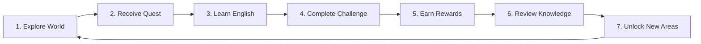

# Game Design Document (GDD)
## English Adventure

| Field | Value |
|---|---|
| **Document Version** | 1.0 |
| **Date** | 2026-11-26 |
| **Status** | Draft |
| **Engine** | Godot 4.x + GDScript |
| **Genre** | 3D/2.5D Cartoon Fantasy Adventure |
| **Target Audience** | Vietnamese-speaking children, age 10, Beginner (Zero-base English) |

---

## Table of Contents

1. [A. Gameplay & Core Loop](#a-gameplay--core-loop)
2. [B. Game Modes (Mini-Games)](#b-game-modes-mini-games)
3. [C. Game Progression](#c-game-progression)
4. [D. Character System](#d-character-system)
5. [E. Reward System](#e-reward-system)
6. [F. World 1 – Alphabet Island (MVP)](#f-world-1--alphabet-island-mvp)

---

## A. Gameplay & Core Loop

### 1. Core Adventure Loop

**English Adventure** is built around an exploration-first loop where English learning is the key to unlocking the world—never a detached quiz screen.

| Stage | Player Experience | Educational Purpose |
|---|---|---|
| **1. Explore World** | Walk/run through 2.5D parallax zones, interact with objects, discover glowing letter ruins | Builds curiosity and spatial ownership |
| **2. Receive Quest** | Talk to NPCs or Buddy; learn why a landmark lost its voice to The Silent Shadow | Establishes narrative motivation |
| **3. Learn English** | Professor Owl or Buddy introduces 3–5 letters/words/patterns with audio + Vietnamese explanation | Direct, scaffolded instruction |
| **4. Complete Challenge** | Play 1–3 mini-games using the newly learned content + prior review words | Active recall across L/S/R/W skills |
| **5. Earn Rewards** | Receive EXP, Gold, 1–3 Stars, and Magic Crystals; watch the world visibly brighten | Positive reinforcement tied to accuracy |
| **6. Review Knowledge** | Short SRS review prompts ("Buddy's Memory Check") before entering new zones | Long-term retention (SM-2) |
| **7. Unlock New Areas** | Magic Crystals power ancient gates to open new island regions or Boss lairs | Tangible adventure progression |

### 2. Session Pacing (Target: 15–20 Minutes)
- **Minutes 0–2:** Buddy greeting + optional 1-minute SRS Quick Review (2–3 due words).
- **Minutes 2–12:** 1–2 Story Quests (each quest = 1 short dialogue + 2–3 mini-game rounds).
- **Minutes 12–15:** Reward celebration, world restoration cutscene, preview next quest.

---

## B. Game Modes (Mini-Games)

All mini-games inherit from `MiniGameBase` and receive `vocab_ids` / `questions` dynamically from the `LearningEngine`. **Zero learning content is hardcoded inside any mini-game.**

### 1. Word Hunt (Reading + Visual Recognition)
- **Objective:** Find hidden objects or glowing word/letter stones inside an interactive 2.5D scene that match a target English word or letter.
- **How to Play:** A target word (with optional audio button) appears at the top. The player pans/taps around a vibrant scene (e.g., jungle clearing, beach) to tap the matching object or letter rune.
- **Rules:** 3–5 targets per round; 3 Hearts (lives); optional soft timer for bonus stars (no hard fail on timer in Difficulty 1).
- **Scoring:** +20 pts per first-try find; +10 pts on second try; streak multiplier (+5 per consecutive hit).
- **Win Condition:** Find all required targets before losing all 3 Hearts.
- **Fail Condition:** Lose all 3 Hearts (player can immediately retry with Buddy's encouragement; no harsh penalty).
- **Correct Feedback:** Object sparkles, flies into the Word Book, plays `word_us.mp3`, Buddy cheers in Vietnamese ("Chính xác! Apple là quả táo!").
- **Wrong Feedback:** Gentle shake animation, Heart dims, Buddy gives a Vietnamese hint ("Gợi ý: Quả này màu đỏ và ăn rất giòn!").
- **English Knowledge Tested:** Sight-word recognition, letter-to-object association, basic reading.
- **Difficulty Scaling:**
  - *Level 1:* 3 objects on screen, audio + image + text shown.
  - *Level 2:* 5 objects on screen, text only (audio on hint).
  - *Level 3:* 7+ objects with visual distractors (e.g., similar colors/shapes).

### 2. Listening Mission (Listening)
- **Objective:** Listen to a native English audio clip (letter sound, word, or short phrase) and select the matching picture, letter, or action.
- **How to Play:** An audio wave pulses from Buddy or an ancient Echo Shell. Player taps to replay anytime, then taps one of 2–4 illustrated cards.
- **Rules:** 5–8 prompts per mission; 3 Hearts; unlimited audio replays.
- **Scoring:** +20 pts per correct answer on first listen; +10 pts if replayed >2 times.
- **Win Condition:** Achieve ≥70% accuracy (e.g., 4/5 correct).
- **Fail Condition:** Accuracy <70% or 0 Hearts remaining.
- **Correct Feedback:** Echo Shell lights up, green checkmark burst, plays confirmation chime + repeats word clearly.
- **Wrong Feedback:** Plays the *wrong* card's actual audio so the child hears the contrast ("Đó là 'ball', còn mình đang tìm 'cat' nhé!"), then lets them retry.
- **English Knowledge Tested:** Phonemic awareness, letter sound vs. letter name discrimination, word/phrase listening comprehension.
- **Difficulty Scaling:**
  - *Level 1:* 2 choices, distinct sounds (e.g., `/æ/` vs `/b/`).
  - *Level 2:* 3 choices, same starting letter or category.
  - *Level 3:* 4 choices, minimal pairs or short sentences ("The cat is big").

### 3. Word Builder (Writing + Phonics)
- **Objective:** Construct an English word by dragging or tapping scrambled letter tiles into the correct slots.
- **How to Play:** An image and audio prompt play (e.g., picture of a cat + `/kæt/`). Scattered letter tiles appear below. Player taps or drags tiles into slots.
- **Rules:** 4–6 words per round; tapping a placed tile returns it to the tray; Hint button reveals the first missing letter.
- **Scoring:** +25 pts per word without hints; +15 pts if 1 hint used; +5 bonus for no wrong tile placements.
- **Win Condition:** Spell all target words in the round.
- **Fail Condition:** Exceed max wrong placements (5 per word triggers auto-assist from Buddy) or exit.
- **Correct Feedback:** Letters glow in sequence sounding out phonics (`/k/ - /æ/ - /t/ -> cat!`), celebratory confetti.
- **Wrong Feedback:** Wrong letter gently bounces back to the tray with a soft "boop" sound; Buddy highlights the phoneme sound needed.
- **English Knowledge Tested:** Spelling, grapheme-to-phoneme mapping, CVC blending.
- **Difficulty Scaling:**
  - *Level 1:* Exact letters needed (3-letter CVC words), first letter pre-filled.
  - *Level 2:* Exact letters, no pre-filled slots.
  - *Level 3:* 2–3 distractor letters added to the tray; 4–6 letter words.

### 4. Sentence Builder (Writing + Grammar)
- **Objective:** Arrange word cards into a grammatically correct English sentence that matches a picture or Vietnamese meaning.
- **How to Play:** A scene/meaning prompt is shown (e.g., "Tôi có một quả táo"). Word tiles (`I`, `have`, `an`, `apple`) sit in a tray. Player orders them on a bridge/scroll.
- **Rules:** 3–5 sentences per round; tapping a word plays its audio; punctuation (`.`) is auto-appended or placed last.
- **Scoring:** +30 pts per sentence on first check; +15 pts on second check.
- **Win Condition:** Build all required sentences correctly.
- **Fail Condition:** 3 failed checks on a single sentence triggers a guided walkthrough by Professor Owl.
- **Correct Feedback:** The sentence bridge solidifies; full sentence audio plays smoothly; Buddy translates and praises.
- **Wrong Feedback:** Incorrectly placed word tiles wiggle in amber; Professor Owl explains the Vietnamese vs. English word order difference briefly.
- **English Knowledge Tested:** Basic syntax (SVO), articles (`a`/`an`), `to be`, `have/has`, `can/can't`.
- **Difficulty Scaling:**
  - *Level 1:* 3-word sentences (`I am [Name]`, `It is red`).
  - *Level 2:* 4–5 word sentences (`I have a cat`).
  - *Level 3:* 1–2 distractor words in tray (e.g., `is` vs `are`).

### 5. Reading Challenge (Reading + Comprehension)
- **Objective:** Read a short, illustrated English passage (1–4 sentences) and answer comprehension questions.
- **How to Play:** An interactive storybook page appears. Players can tap *any* individual word to hear its pronunciation and see a tiny Vietnamese gloss if needed (scaffolded reading). Below or on the next card, 2–3 comprehension questions appear.
- **Rules:** 1–2 passages per challenge; tap-to-hear allowed, but using full-sentence translation counts as a hint.
- **Scoring:** +25 pts per comprehension question answered correctly without full translation.
- **Win Condition:** Answer ≥70% of comprehension questions correctly.
- **Fail Condition:** Score <70% (can replay immediately).
- **Correct Feedback:** Story illustration animates! Character in the story reacts happily.
- **Wrong Feedback:** The relevant sentence in the passage highlights in yellow so the child learns *where* to find the answer.
- **English Knowledge Tested:** Reading fluency, vocabulary in context, literal comprehension.
- **Difficulty Scaling:**
  - *Level 1:* 1–2 simple sentences, 2-option image questions.
  - *Level 2:* 3–4 sentences, 3-option text+image questions.
  - *Level 3:* Short dialogue between 2 characters, inference question.

### 6. Speaking Challenge (Speaking — MVP vs. Future)
- **MVP Implementation:** **Listen & Repeat + Self-Rating**.
  - **Objective:** Encourage children to speak English aloud without fear of harsh AI rejection.
  - **How to Play:** Buddy says a word/phrase clearly. Player presses & holds the Microphone button to record their voice (saved locally in temp buffer only, never uploaded in MVP), plays back their own voice alongside Buddy's voice, and taps a 3-face self-rating ("Giống rồi! 🌟" / "Tạm ổn 👍" / "Thử lại nhé 🔄").
  - **Note:** Awards participation EXP, but **cannot** grant Vocabulary Mastery on its own (prevents gaming the system).
- **Post-MVP (World 5+):** Automated Pronunciation Assessment (phoneme-level scoring).

### 7. Boss Battle (Integrated Multi-Skill Challenge)
- **Objective:** Defeat a lieutenant of The Silent Shadow (e.g., **Shadow Silencer** at the end of Alphabet Island) using all learned skills.
- **How to Play:** Multi-phase encounter (3 phases = 3 HP bars on the Boss).
  - *Phase 1:* Listening Mission (block Shadow's silence waves by identifying sounds).
  - *Phase 2:* Word Builder (forge Magic Words to break the Shadow shield).
  - *Phase 3:* Sentence Builder / Reading (cast the Restoration Spell).
- **Win Condition:** Deplete all 3 Boss HP bars before player loses 3 Hearts.
- **Fail Condition:** Player loses 3 Hearts → Boss laughs and retreats; Buddy heals player and suggests reviewing weak words before retrying.

---

## C. Game Progression

### 1. Currencies & Metrics
| Metric | Source | Purpose |
|---|---|---|
| **EXP & Player Level** | Quests, mini-games, daily reviews | Unlocks cosmetic badges and level titles (Level 1–50) |
| **Gold** | Mini-game performance, daily streaks | Buy avatar accessories & Buddy skins (cosmetic only—no pay-to-win) |
| **Stars (0–3 per Quest)** | Accuracy-based: 70%+ = 1★, 85%+ = 2★, 95%+ & no hints = 3★ | Measures mastery quality; required for World Boss unlock |
| **Magic Crystals** | Story quest milestones & Boss victories | Narrative key items that restore landmarks and unlock new Worlds |

### 2. Unlocking Rules & Anti-Grinding
- **Quest Unlocking:** Sequential within a region, with optional side-quests.
- **Boss Unlocking (World 1):** Complete all core Alphabet Island quests AND earn at least **60% of total Stars** + **50% of World 1 vocabulary at Mastery Level ≥ 2**.
- **World Unlocking:** Defeat World Boss + collect required Magic Crystals.
- **Anti-Grinding Rule:** Repeating an already-completed quest grants **diminished EXP/Gold (20%)** and **does NOT increase Vocabulary Mastery** unless the word is genuinely due for SRS review. Random guessing is detected by rapid-tap penalties (<800ms) and resets the streak.

---

## D. Character System

| Character | Role | Personality & Voice |
|---|---|---|
| **Explorer (Boy / Girl)** | Player Avatar | Curious, brave young adventurer; customizable outfits via Gold |
| **Buddy (Little Dragon)** | AI Companion | Energetic, warm, empathetic. Speaks Vietnamese for encouragement/explanations and simple English for practice. Never scolds. |
| **Professor Owl** | Mentor / Teacher | Wise, gentle scholar in spectacles. Explains phonics rules (e.g., letter name vs. letter sound) clearly in Vietnamese. |
| **Island NPCs** | Quest Givers | E.g., *Chef Mango* (food vocab), *Captain Fin* (ocean/colors), *Pip the Squirrel* (animals). |
| **Shadow Silencer** | World 1 Boss | Mischievous shadow creature who steals sounds; defeated by speaking/building words. |

### Animation States (2.5D Sprite / Spine / Godot AnimatedSprite2D)
- `idle`, `walk`, `happy_jump`, `think`, `encourage`, `celebrate`, `hit_stun` (Boss/Player).

---

## E. Reward System

1. **Performance-Tied Rewards:** 3-Star mastery yields 1.5x Gold and bonus Achievement progress compared to 1-Star completion.
2. **Visual World Restoration:** Each Magic Crystal visibly restores color, music, and animated wildlife to a silenced zone on Alphabet Island.
3. **Achievements:** Milestone badges (e.g., *"Vowel Explorer"*, *"10-Word Streak"*, *"7-Day Adventurer"*).
4. **Mastery Integrity:** Mastery Level (0–5) only advances via **Spaced Repetition (SM-2)** across separate days/sessions and multiple mini-game types—never by grinding one game in 5 minutes.

---

## F. World 1 – Alphabet Island (MVP)

### Map Layout (4 Regions)
1. **Sunlit Beach (Letters A–G):** Tutorial, vowels A/E, basic greetings, animals (`cat`, `dog`), food (`apple`).
2. **Whispering Palms (Letters H–N):** Consonants, colors (`red`, `blue`, `green`), numbers (`one`–`five`).
3. **Echo Caves (Letters O–T):** Short vowels O, CVC Word Builder focus, school objects (`book`, `pen`).
4. **Crystal Peak & Shadow Altar (Letters U–Z + Boss):** Final consonants, Sentence Builder (`I have...`, `It is...`), Boss Battle vs. **Shadow Silencer**.

### MVP Content Target
- **26 Letters** (explicitly separating Letter Name vs. Letter Sound).
- **100–150 Vocabulary Words** (food, animals, colors, numbers, objects, basic verbs/adjectives).
- **15–20 Quests** (including 1 Boss Quest).
- **10–15 Basic Sentence Structures** (`I am...`, `I have a...`, `It is a...`, `I can...`, `There is...`).
