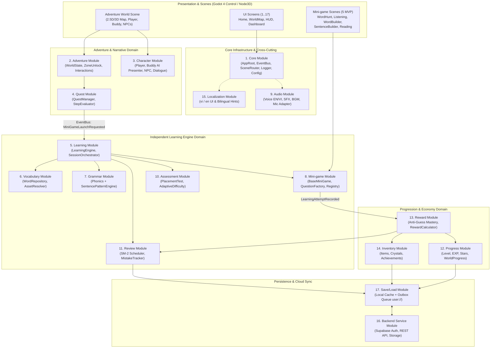
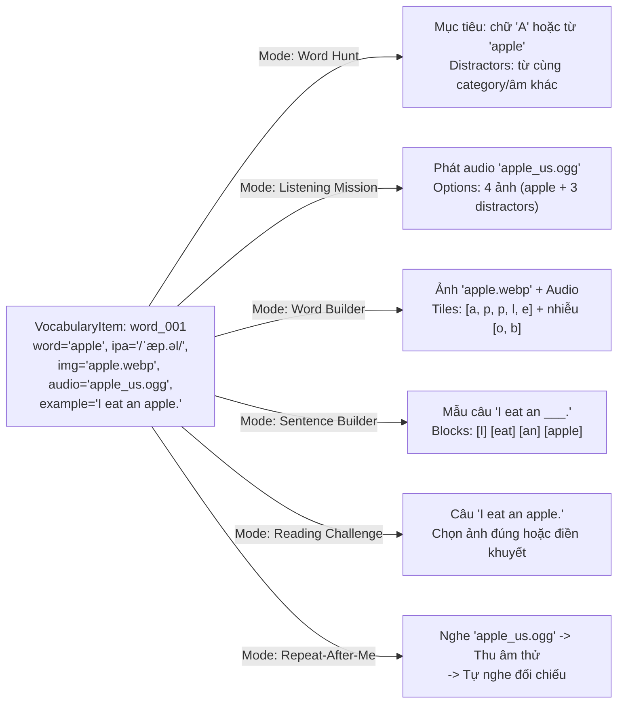
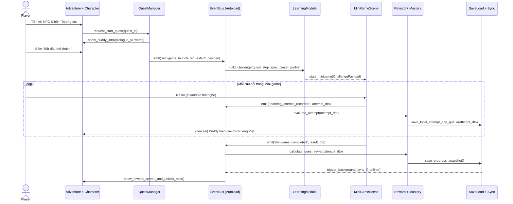

# SOFTWARE ARCHITECTURE DOCUMENT
# PROJECT: ENGLISH ADVENTURE

**Game Engine:** Godot 4.3+ (GDScript, `gl_compatibility` renderer)  
**Backend:** Supabase (PostgreSQL, Supabase Auth, Supabase Storage, PostgREST REST API)  
**Nền tảng mục tiêu:** Android, iOS, Web (WebGL2), Desktop (Windows/macOS)  

---

## 1. NGUYÊN TẮC KIẾN TRÚC CỐT LÕI

1. **Modular Architecture (17 Modules tách biệt):** Mỗi module có trách nhiệm duy nhất (Single Responsibility), giao tiếp qua giao diện rõ ràng và `EventBus`.
2. **Tách rời hoàn toàn Learning Engine và Adventure Engine:**
   - `AdventureEngine` chỉ biết bản đồ, tọa độ, NPC, trạng thái quest và trigger.
   - `LearningEngine` không biết gì về thế giới 3D/2.5D; nó nhận `learning_unit_ids` hoặc `quest_config` và sinh ra câu hỏi/mini-game từ dữ liệu JSON/DB.
3. **Content-Driven & Reusable Vocabulary:** Một bản ghi từ vựng (ví dụ `word_001: "apple"`) nằm duy nhất ở `ContentRepository` và được tái sử dụng tự động cho *Word Hunt, Listening Mission, Word Builder, Sentence Builder, Reading Challenge, Speaking* mà không nhân bản dữ liệu và không viết logic học trùng lặp trong từng mini-game.
4. **Offline-First & Idempotent Sync:** Mọi thao tác chơi và học lưu ngay xuống Local Storage trước, đồng bộ bất đồng bộ lên Supabase khi có kết nối mạng.
5. **Security by Default:** Không lưu `SUPABASE_SERVICE_ROLE_KEY` trong client Godot; toàn bộ truy cập DB đi qua Anon Key + User JWT + PostgreSQL Row Level Security (RLS).

---

## 2. SƠ ĐỒ KIẾN TRÚC TỔNG THỂ (MERMAID)

---

## 3. CHI TIẾT 17 MODULES BẮT BUỘC

| # | Tên Module | Thư mục dự kiến (`scripts/`) | Trách nhiệm chính | Phụ thuộc cho phép |
|---|---|---|---|---|
| **1** | **Core Module** | `scripts/core/` | Khởi động app, `EventBus` (Signals toàn cục), `SceneRouter`, `AppConfig`, `Logger`, `DataValidator`, `ErrorHandler`. | Không phụ thuộc domain modules. |
| **2** | **Adventure Module** | `scripts/adventure/` | Quản lý trạng thái thế giới, Zone unlocking, tương tác vật thể/cổng, camera follow, vị trí spawn nhân vật. | Core, Quest, Character, Audio. |
| **3** | **Character Module** | `scripts/character/` | Điều khiển Player (Touch Joystick + Keyboard), Buddy companion logic (nhắc việc, giải thích tiếng Việt), NPC trigger, Dialogue Runner, Animation State Machine. | Core, Adventure, Localization, Audio. |
| **4** | **Quest Module** | `scripts/quest/` | Nạp định nghĩa Quest từ `data/quests/`, theo dõi `quest_steps`, phát sự kiện chuyển sang bước học hoặc mini-game, cập nhật trạng thái Quest. | Core, Progress, Learning (chỉ qua DTO/EventBus). |
| **5** | **Learning Module** | `scripts/learning/` | Điều phối phiên học (`LearningSession`), kết hợp Vocabulary + Phonics + Grammar để tạo payload chuẩn cho mini-game và đánh giá kết quả học thuật. | Core, Vocabulary, Grammar, Audio. |
| **6** | **Vocabulary Module** | `scripts/learning/vocabulary/` | Truy vấn và cache dữ liệu từ vựng, ánh xạ `word_id` → hình ảnh/audio/IPA/ví dụ; lọc từ theo skill, difficulty, category. | Core, Backend/Save (content pack). |
| **7** | **Grammar Module** | `scripts/learning/grammar/` | Quản lý Phonics rules (Letter Name vs Letter Sound, Blending) và Grammar Sentence Patterns (tách slot cấu trúc câu để sinh bài tập Sentence Builder & Reading). | Core, Vocabulary. |
| **8** | **Mini-game Module** | `scripts/mini_games/` | Định nghĩa lớp cơ sở `BaseMiniGame`, `MiniGameRegistry`, các Widget dùng chung (LetterTile, WordCard, FeedbackBanner) và 5 mini-games MVP. | Core, Learning (nhận `MiniGameChallengeDTO`), Audio, Localization. |
| **9** | **Audio Module** | `scripts/audio/` | Quản lý Audio Buses (`Master`, `BGM`, `SFX`, `VoiceEN`, `VoiceVI`), preloading clip từ vựng, fallback `en-GB` → `en-US`, và `AudioCaptureAdapter` cho Repeat-After-Me. | Core, Save (settings). |
| **10** | **Assessment Module** | `scripts/assessment/` | Thực hiện Initial Placement Check (kèm tùy chọn "Chưa biết"), tính mức độ ban đầu và `AdaptiveDifficulty` (điều chỉnh số lựa chọn nhiễu/tốc độ theo hiệu suất). | Core, Learning, Progress. |
| **11** | **Review Module** | `scripts/progression/review/` | Tính lịch ôn tập Spaced Repetition (Modified SM-2), ưu tiên từ sai nhiều, tạo `ReviewSession` độc lập khỏi Quest. | Core, Vocabulary, Save. |
| **12** | **Progress Module** | `scripts/progression/` | Lưu & cập nhật `player_level`, `exp`, `stars`, `world_progress`, `lesson_progress`, `quest_progress`. | Core, Save. |
| **13** | **Reward Module** | `scripts/progression/` | Tính toán EXP, Gold, Stars và **Anti-Guess Mastery Algorithm** từ mỗi `learning_attempt`. | Core, Progress, Review, Inventory. |
| **14** | **Inventory Module** | `scripts/progression/` | Quản lý vật phẩm, Crystal Shards, Magic Crystals, Achievements & điều kiện mở khóa huy hiệu. | Core, Progress, Save. |
| **15** | **Localization Module** | `scripts/localization/` | Nạp bảng dịch `vi`/`en` cho UI, định dạng câu song ngữ cho Buddy, quản lý hiển thị font tiếng Việt + IPA. | Core. |
| **16** | **Backend Service Module** | `scripts/services/` | Bọc giao tiếp HTTP REST tới Supabase (Auth, PostgREST, Storage), quản lý refresh JWT token, retry exponential backoff, telemetry lỗi. | Core. |
| **17** | **Save/Load Module** | `scripts/services/persistence/` | Đọc/ghi trạng thái người chơi tại `user://`, quản lý `sync_outbox.json`, hợp nhất dữ liệu local/cloud khi online (Conflict Resolution). | Core, Backend Service. |

---

## 4. CƠ CHẾ TÁI SỬ DỤNG TỪ VỰNG XUYÊN SUỐT (REUSABLE VOCABULARY PIPELINE)

Ví dụ từ `"word_001"` (`apple`) chỉ tồn tại **1 lần** trong `data/vocabulary/world_01_vocab.json` (và bảng `vocabulary`). Khi một Quest yêu cầu kiểm tra `word_001` qua nhiều kỹ năng, `QuestionGeneratorService` trong `Learning Module` tự động chuyển đổi `VocabularyItem` thành các `ChallengeItem` khác nhau:

**Kết quả kiến trúc:**
- **Không** có logic học từ vựng riêng bị lặp lại trong từng scene mini-game.
- Mini-game chỉ nhận đầu vào chuẩn `MiniGamePayload` và trả ra đầu ra chuẩn `MiniGameResult` + danh sách `LearningAttemptEvent`.

---

## 5. LUỒNG DỮ LIỆU & GIAO TIẾP SIGNAL / EVENTBUS

### 5.1. Luồng chạy một Quest hoàn chỉnh (Sequence Diagram)

### 5.2. Danh sách Signals cốt lõi trên `EventBus`
- `app_state_changed(new_state: StringName)`
- `network_status_changed(is_online: bool)`
- `auth_session_updated(user_id: String, is_anonymous: bool)`
- `quest_started(quest_id: String)` / `quest_step_completed(quest_id: String, step_index: int)` / `quest_completed(quest_id: String, stars: int)`
- `minigame_launch_requested(launch_config: Dictionary)`
- `minigame_completed(result: Dictionary)`
- `learning_attempt_recorded(attempt: Dictionary)`
- `mastery_updated(word_id: String, new_score: float, new_level: int)`
- `reward_granted(reward_bundle: Dictionary)`
- `buddy_prompt_requested(message_key: String, context: Dictionary)`
- `sync_completed(synced_count: int, failed_count: int)`

---

## 6. SERVICE INTERFACES (HỢP ĐỒNG GIAO TIẾP GIỮA CÁC MODULE)

Mặc dù GDScript là ngôn ngữ dynamic/gradual typing, các service cốt lõi tuân theo **hợp đồng hàm rõ ràng (typed GDScript signatures + Resource/DTO classes)**:

1. **`IContentProvider` (`VocabularyModule` / `GrammarModule`):**
   - `get_word(word_id: String) -> VocabularyResource`
   - `query_words(filter: Dictionary) -> Array[VocabularyResource]` (hỗ trợ `world_id`, `category`, `difficulty`, `skill`)
   - `get_distractor_words(target_word_id: String, count: int, strategy: String) -> Array[VocabularyResource]`
   - `get_phonics_unit(phonics_id: String) -> PhonicsResource`
   - `get_sentence_pattern(pattern_id: String) -> GrammarPatternResource`

2. **`IMiniGame` (`BaseMiniGame`):**
   - `setup(challenge_payload: MiniGamePayload) -> void`
   - `start_game() -> void`
   - `pause_game() -> void`
   - `resume_game() -> void`
   - `abort_game() -> void`
   - Signal bắt buộc: `attempt_made(attempt: LearningAttemptDTO)`, `game_finished(result: MiniGameResultDTO)`

3. **`IBackendGateway` (`BackendService`):**
   - `sign_in_anonymous() -> AuthResult`
   - `sign_in_with_email(email: String, password: String) -> AuthResult`
   - `fetch_player_snapshot(profile_id: String) -> SyncResult`
   - `push_sync_batch(events: Array[Dictionary]) -> SyncBatchResult`
   - `download_content_manifest(world_id: String) -> ManifestResult`

4. **`IPersistenceStore` (`SaveLoadModule`):**
   - `save_profile_state(profile_id: String, state: Dictionary) -> Error`
   - `load_profile_state(profile_id: String) -> Dictionary`
   - `enqueue_sync_event(event_type: String, payload: Dictionary) -> void`
   - `get_pending_sync_events(limit: int) -> Array[Dictionary]`
   - `mark_events_synced(client_event_ids: Array[String]) -> void`

---

## 7. ERROR HANDLING, LOGGING, OFFLINE & SYNCHRONIZATION

### 7.1. Error Handling & Logging
- Mọi lỗi được phân loại qua `AppLogger`: `DEBUG`, `INFO`, `WARN`, `ERROR`, `FATAL`.
- Lưu log xoay vòng (rolling log tối đa 2 file x 512 KB) tại `user://logs/app.log`, **tự động loại bỏ (redact)** token JWT hoặc dữ liệu nhạy cảm trước khi ghi.
- **Lỗi mạng / API (4xx/5xx/Timeout):**
  - Không làm treo game hoặc mất màn chơi hiện tại.
  - Tự động chuyển sang chế độ Offline mượt mà với thông báo nhỏ thân thiện (*"Đang chơi ngoại tuyến – Tiến trình vẫn được lưu trên máy!"*).
  - Retry theo chiến lược **Exponential Backoff** (`2s → 4s → 8s → 30s`) cho các yêu cầu nền.
- **Lỗi thiếu tài nguyên học tập (missing audio/image):**
  - `AssetResolver` dùng placeholder an toàn + ghi log cảnh báo + tự bỏ qua từ bị lỗi khi sinh distractor để game không crash.

### 7.2. Chiến lược Offline & Synchronization
1. **Nội dung học tập (Read-only Content):**
   - World 1 (Alphabet Island) được đóng gói sẵn (bundled) trong bản cài MVP để **chơi được 100% offline ngay sau khi cài**.
   - Các gói nội dung mới hoặc bản vá được kiểm tra qua `content_version` trên Supabase khi có mạng.
2. **Dữ liệu người chơi (Read/Write Player Data):**
   - Ghi đồng bộ xuống đĩa (atomic write: ghi file `.tmp` rồi rename) sau mỗi bước hoàn thành.
   - Mỗi hành động học tập (`learning_attempts`) và cập nhật tiến trình được đẩy vào `sync_outbox.json` kèm `client_event_id = UUIDv4` và `occurred_at_utc`.
3. **Giải quyết xung đột (Conflict Resolution) khi đồng bộ đa thiết bị:**
   - `learning_attempts`: **Append-only (Idempotent)** theo `client_event_id` UNIQUE trên PostgreSQL — không bao giờ trùng lặp dù gửi lại nhiều lần.
   - `player_progress` / `player_quest_progress`: **Monotonic High-Water Mark** — `stars`, `best_score`, `exp`, `completed` chỉ tăng hoặc giữ giá trị cao nhất; `vocabulary_mastery` tính lại/hợp nhất theo timestamp mới nhất kèm lịch sử attempt.
   - `gold` / `inventory`: Ghi nhận qua các giao dịch có `client_event_id` để tránh cộng/trừ lặp.

---

## 8. TRẠNG THÁI TRIỂN KHAI THỰC TẾ (CẬP NHẬT PROMPT 02)

Các thành phần đã triển khai thành GDScript & Scene thực thi trong `project.godot`:
- **Autoloads đã đăng ký (`[autoload]`):** `AppLogger`, `EventBus`, `LocalizationManager`, `DataRepository`, `SaveLoadManager`, `GameStateManager`, `QuestManager`, `SceneRouter`.
- **Hệ thống Adventure & Character:** `AreaExplorationController`, `UnlockEvaluator`, `InteractionManager`, `InteractableObject`, `PlayerController`, `CharacterAnimator`, `BuddyController`, `NpcController`, `DialogueManager`.
- **Điểm nối cho Prompt 03+:** `EventBus.learning_hook_requested` và `quest.learning_hook` sẵn sàng kết nối `LearningEngine` & 5 Mini-games mà không cần sửa kiến trúc thế giới hay nhân vật.
