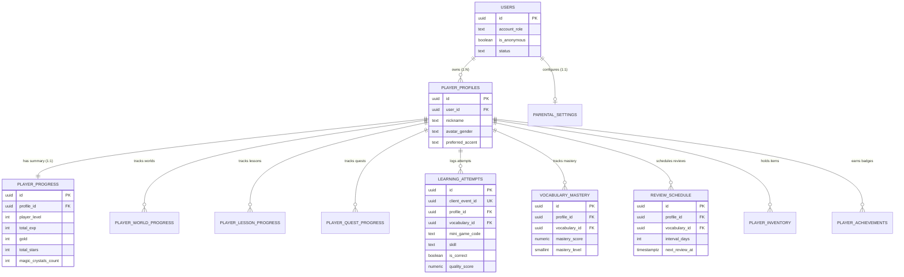
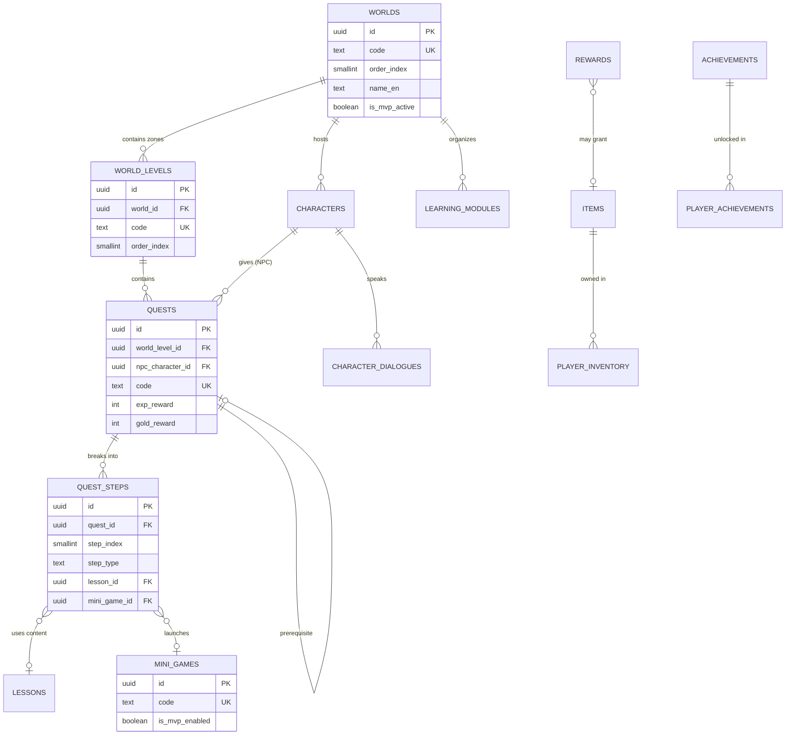
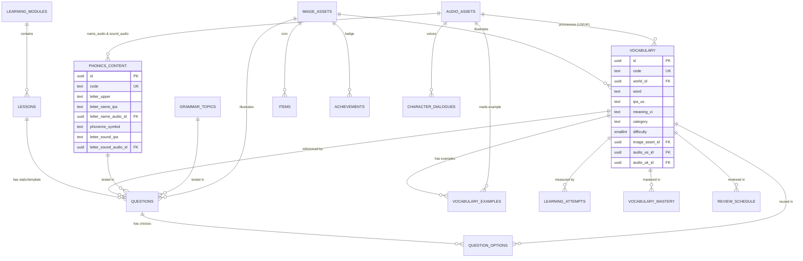

# ENTITY RELATIONSHIP DIAGRAM (ERD)
# PROJECT: ENGLISH ADVENTURE

Tài liệu này trực quan hóa toàn bộ 32 bảng PostgreSQL trên Supabase (bao gồm đủ 31 bảng yêu cầu trong Task 04 và đầy đủ tách bảng media) cùng giải thích chi tiết các mối quan hệ.

---

## 1. ERD – NHÓM USER MANAGEMENT & PLAYER DATA

---

## 2. ERD – NHÓM GAME WORLD, QUESTS & REWARDS

---

## 3. ERD – NHÓM LEARNING CONTENT & MEDIA ASSETS

---

## 4. GIẢI THÍCH QUAN HỆ GIỮA CÁC BẢNG TRỌNG YẾU

1. **Tách `users` và `player_profiles` (`1:N`):**
   - Một tài khoản phụ huynh (`users`) có thể quản lý 1 hoặc nhiều hồ sơ học tập của con (`player_profiles`) trên cùng thiết bị/gia đình mà vẫn giữ nguyên thông tin đăng nhập duy nhất.
2. **Tái sử dụng `vocabulary` qua `quest_steps` → `lessons` → `questions` / Dynamic Generator:**
   - `vocabulary` đóng vai trò **Single Source of Truth**. Mỗi từ chỉ lưu 1 lần với hình ảnh (`image_assets`), âm thanh US/UK (`audio_assets`), IPA và ví dụ (`vocabulary_examples`).
   - Một `quest_step` trỏ tới `lesson_id` + `mini_game_id`. Tùy theo `mini_game_code`, `LearningEngine` có thể lấy câu hỏi dựng sẵn từ `questions` hoặc sinh câu hỏi động trực tiếp từ `vocabulary` & `grammar_topics`.
3. **Tách biệt `letter_name_audio_id` và `letter_sound_audio_id` trong `phonics_content`:**
   - Ràng buộc dữ liệu bắt buộc hai FK trỏ về hai file âm thanh độc lập của `audio_assets`, ngăn lỗi trộn lẫn tên chữ cái và âm chữ cái.
4. **Chuỗi dữ liệu học thuật `learning_attempts` → `vocabulary_mastery` → `review_schedule`:**
   - `learning_attempts` lưu lịch sử từng lần chạm/trả lời (kèm `client_event_id` chống trùng lặp khi đồng bộ offline).
   - Từ `learning_attempts`, hệ thống cập nhật điểm `vocabulary_mastery` (áp dụng logic chống đoán bừa) và tính lại ngày ôn kế tiếp `next_review_at` trong `review_schedule`.
5. **Cách ly hoàn toàn dữ liệu người chơi (`player_*`):**
   - Tất cả 9 bảng tiến trình người chơi đều mang khóa ngoại `profile_id` → `player_profiles(id)` và được kiểm soát chặt qua RLS `is_profile_owner(profile_id)`.
