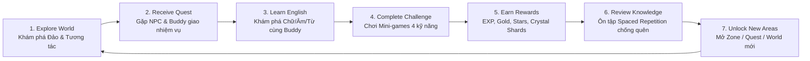

# GAME DESIGN DOCUMENT (GDD)
# PROJECT: ENGLISH ADVENTURE

**Thể loại:** 2.5D/3D Stylized Cartoon Educational Adventure  
**Đối tượng:** Trẻ em 10 tuổi mất gốc tiếng Anh (Zero → Pre-A1 → A1 → A2)  
**Ngôn ngữ hướng dẫn:** Tiếng Việt | **Ngôn ngữ học:** Tiếng Anh  

---

## 1. CỐT TRUYỆN & THẾ GIỚI GAME

### 1.1. Tiền đề cốt truyện
Vùng đất phép thuật **Lingua Realm** từng rực rỡ âm thanh, nơi mọi sinh vật trò chuyện bằng ánh sáng của Ngôn ngữ. Thế lực bóng tối **The Silent Shadow** đã phủ màn sương câm lặng lên 6 vùng đất, làm các chữ cái tan rã, âm thanh biến mất và cư dân quên mất cách giao tiếp.

Người chơi vào vai một **Nhà Thám Hiểm Trẻ Tuổi** (Explorer Nam hoặc Nữ), được **Professor Owl** trao cho chiếc la bàn ánh sáng và kết bạn với **Buddy** — một chú rồng nhỏ giữ ngọn lửa âm thanh cuối cùng. Để đánh bại *The Silent Shadow*, người chơi phải du hành qua từng vùng đất, khôi phục chữ cái, từ vựng, câu nói và thu thập đủ **Magic Crystals** bị phong ấn.

### 1.2. Cấu trúc 6 Worlds (Bức tranh tổng thể & Phạm vi MVP)

> **Nguyên tắc xuyên suốt:** 6 thế giới là cách tổ chức cốt truyện và chủ đề trọng tâm. **Cả 4 kỹ năng (Listening, Speaking, Reading, Writing) được tích hợp ở mọi thế giới.**

| World | Tên thế giới | Trọng tâm nội dung | Trạng thái |
|---|---|---|---|
| **World 1** | **Alphabet Island** | 26 chữ cái, Letter Name vs Letter Sound, Vowels/Consonants, Basic Phonics, Simple Blending (CVC) thông qua 100–150 từ neo & 10–15 câu cơ bản. | **MVP (Triển khai đầy đủ – 18 Quests)** |
| **World 2** | **Vocabulary Forest** | Animals, Family, Colors, Numbers, Food & Drinks, Body Parts, School Objects, Nature, Daily Objects. | Post-MVP |
| **World 3** | **Sentence Kingdom** | Pronouns, Nouns, Verbs, Adjectives, To be, Have/Has, There is/are, Present Simple, Can/Can't, Basic sentence structures. | Post-MVP |
| **World 4** | **Listening Ocean** | Word, Phrase, Sentence Listening, Short Conversations, Listening Comprehension. | Post-MVP |
| **World 5** | **Speaking City** | Greetings, Introducing Yourself, Family Conversations, Shopping, Asking for Directions, Daily Communication. | Post-MVP |
| **World 6** | **Challenge Kingdom** | Listening/Speaking/Reading/Writing Challenges, Integrated English Missions, Final Boss Challenge. | Post-MVP |

### 1.3. Chi tiết bản đồ MVP: World 1 – Alphabet Island (5 Khu Vực, Chuẩn Hóa Prompt 02)
1. **Area 1 – Welcome Village (`welcome_village`):** Làng khởi đầu, nhà của Professor Owl, quảng trường trung tâm, bé Lily, hướng dẫn điều khiển cơ bản & Quest 01.
2. **Area 2 – Alphabet Meadow (`alphabet_meadow`):** Đồng cỏ bảng chữ cái A–Z, biển chỉ dẫn, các chữ cái thất lạc (`A, B, C`) & Rương Kho Báu (Quest 02).
3. **Area 3 – Letter Cave (`letter_cave`):** Hang động bí ẩn, nhân vật **Rocky**, bia đá cổ và manh mối mở đường tới hồ phép thuật.
4. **Area 4 – Crystal Lake (`crystal_lake`):** Hồ nước phép thuật, **Crystal Guardian**, thu thập Mảnh Pha Lê Phép Thuật (Quest 03).
5. **Area 5 – The Shadow Gate (`shadow_gate`):** Cánh cổng cổ bị *The Silent Shadow* phong ấn — mục tiêu lớn của Alphabet Island (nơi nối vào thử thách tổng hợp cuối World 1 ở giai đoạn học tập).

*(Lộ trình nội dung học đầy đủ gồm 18 Quests ở các giai đoạn tiếp theo vẫn mở rộng trực tiếp trên 5 khu vực này thông qua dữ liệu JSON).*

---

## 2. VÒNG LẶP CHƠI CỐT LÕI (CORE GAMEPLAY LOOP)

### Mô tả chi tiết từng bước vòng lặp:
1. **Explore World:** Người chơi điều khiển nhân vật chạy nhảy trên bản đồ 2.5D/3D (nhặt xu sáng, mở rương chữ cái ẩn, nghe hiệu ứng môi trường phát âm thanh khi chạm vật thể).
2. **Receive Quest:** Tiến lại gần NPC có biểu tượng `!` (hoặc Buddy nhắc). NPC kể vấn đề bằng câu chuyện ngắn; **Buddy dịch và giải thích nhiệm vụ bằng tiếng Việt** rõ ràng.
3. **Learn English (Guided Discovery):** Trước khi thi đấu, Buddy giới thiệu 3–6 đơn vị kiến thức mới (chữ cái/âm/từ/câu) với hình ảnh + phát âm chuẩn + nút *"Nghe lại"* và *"Đọc thử theo Buddy"*.
4. **Complete Challenge:** Người chơi bước vào 1–2 mini-game tương ứng với bước của Quest (ví dụ: săn chữ cái ở *Word Hunt* rồi ghép từ ở *Word Builder*).
5. **Earn Rewards:** Dựa vào độ chính xác thực chất (first-try accuracy, không đoán bừa), hệ thống trao 1–3 Stars, EXP, Gold và mảnh Magic Crystal.
6. **Review Knowledge:** Những từ/âm bị sai hoặc đến hạn ôn tập được đưa vào **Buddy's Review Bag** (hoặc nhiệm vụ ôn tập đầu ngày) trước khi mở thử thách lớn.
7. **Unlock New Areas:** Đủ Stars/Quest hoàn thành sẽ xua tan màn sương *Silent Shadow*, mở cầu/cổng sang Zone tiếp theo.

---

## 3. KIẾN TRÚC 7 MINI-GAMES (GAME MODES)

> Mọi mini-game kế thừa từ `BaseMiniGame`, nhận dữ liệu động từ `LearningEngine` (không hardcode từ vựng).

### 3.1. Word Hunt (Săn Chữ & Săn Từ) — `[MVP Mandatory]`
- **Mục tiêu:** Rèn nhận diện chữ cái (hoa/thường), phân biệt âm chữ cái với tên chữ cái, và liên kết từ với hình ảnh trong không gian phiêu lưu.
- **Cách chơi:** Trong khu vực mini-game hoặc góc bản đồ tương tác, nhiều bong bóng/tinh thể chữ cái hoặc vật phẩm mang từ xuất hiện cùng chướng ngại nhỏ. Nghe Buddy đọc âm/từ mục tiêu (hoặc xem hình) → chạy tới hoặc chạm đúng mục tiêu cần tìm trong thời gian thoải mái.
- **Quy tắc:** Mỗi vòng gồm 5–8 mục tiêu; chọn sai làm tinh thể rung nhẹ và Buddy nhắc lại âm đúng, không làm "Game Over" ngay lập tức.
- **Cách tính điểm:**
  - Đúng ngay lần chạm đầu tiên: `+100 pts` + `+1 Streak`.
  - Đúng sau 1 lần nhầm: `+50 pts` (reset streak, không tính full mastery).
  - Sai >= 2 lần cùng mục tiêu: `+10 pts` sau khi Buddy chỉ dẫn rõ, gắn cờ `needs_review`.
- **Điều kiện thắng:** Thu thập đủ số mục tiêu của màn (ví dụ 6/6 mục tiêu).
- **Điều kiện thất bại:** Hết tim hỗ trợ (3–5 tim ở chế độ thử thách) hoặc người chơi thoát giữa chừng (có thể bấm "Thử lại" ngay không mất toàn bộ tiến trình bài học).
- **Phản hồi khi đúng:** Tinh thể phát sáng, đọc lại từ/âm rõ ràng, hiệu ứng pháo hoa nhỏ, Buddy khen (*"Awesome! / Tuyệt vời!"*).
- **Phản hồi khi sai:** Rung nhẹ (không giật gắt), Buddy xuất hiện nói tiếng Việt: *"Gần đúng rồi! Âm /æ/ là của chữ A như trong 'apple', không phải chữ E nha!"*.
- **Kiến thức kiểm tra:** Letter recognition (uppercase/lowercase), Letter sound vs Letter name, Word-to-Image mapping.
- **Điều chỉnh độ khó:**
  - *Dễ:* 2–3 lựa chọn phân biệt rõ hình dạng (`A` vs `O`), có hiện hình gợi ý.
  - *Trung bình:* 4–5 lựa chọn, không hiện mặt chữ mục tiêu (chỉ nghe âm).
  - *Khó:* Kèm các cặp dễ nhầm (`b/d`, `p/q`, `m/n`) và thời gian thưởng tốc độ.

### 3.2. Listening Mission (Nhiệm Vụ Giải Mã Âm Thanh) — `[MVP Mandatory]`
- **Mục tiêu:** Phát triển kỹ năng **Listening** – nghe hiểu âm vị, từ vựng và câu ngắn từ giọng chuẩn bản ngữ.
- **Cách chơi:** Radar/Máy thu âm phép thuật phát một âm, từ hoặc câu ngắn (có nút nghe lại chậm 0.85x và tốc độ thường 1.0x). Người chơi chọn hình ảnh, chữ cái hoặc hành động tương ứng trong 3–4 phương án trực quan.
- **Quy tắc:** Tối thiểu 6–10 lượt nghe mỗi nhiệm vụ. Bắt buộc nghe hết âm lần đầu trước khi chọn để hạn chế bấm đại trong < 400ms.
- **Cách tính điểm:** `Base 100 pts` nếu đúng lần 1 ở tốc độ 1.0x; `85 pts` nếu dùng nút nghe chậm; `40 pts` nếu đúng ở lần 2.
- **Điều kiện thắng:** Đạt >= 60% số câu đúng (tối thiểu 1 sao; >= 80% = 2 sao; >= 95% first-try = 3 sao).
- **Điều kiện thất bại:** Đạt < 60% số câu đúng (gợi ý học lại cùng Buddy rồi thử lại).
- **Phản hồi đúng/sai:** Khi đúng hiển thị sóng âm xanh lá + mặt chữ + nghĩa Việt ngắn. Khi sai phát lại âm vừa chọn sai song song với âm đúng để tai trẻ phân biệt sự khác biệt.
- **Kiến thức kiểm tra:** Phoneme discrimination, Word listening, Short phrase/sentence listening.
- **Điều chỉnh độ khó:** Tăng từ 2 phương án → 4 phương án; chuyển từ từ đơn → cặp từ gần âm (*cat/hat*, *pen/ten*) → câu ngắn (*"The cat is red."*).

### 3.3. Word Builder (Xưởng Ghép Từ) — `[MVP Mandatory]`
- **Mục tiêu:** Rèn **Writing (Spelling)** và **Phonics Blending** — hiểu cấu tạo từ từ âm và chữ cái.
- **Cách chơi:** Hiển thị hình ảnh minh họa rõ ràng + nút loa phát âm từ (kèm nghĩa tiếng Việt nhỏ phía dưới nếu là bài mới). Bên dưới là các ô trống và khay các khối chữ cái (Letter Tiles) bị xáo trộn cộng 1–2 chữ cái nhiễu. Trẻ kéo-thả hoặc chạm lần lượt từng chữ cái để ghép thành từ hoàn chỉnh.
- **Quy tắc:** Có thể bấm vào chữ đã đặt để trả về khay. Nút gợi ý của Buddy mở tối đa 1 chữ cái đầu tiên (có trừ nhẹ điểm thưởng sao, không tính full first-try mastery).
- **Cách tính điểm:** Đúng nguyên từ ở lần kiểm tra đầu tiên không dùng gợi ý: `+120 pts`; sai 1–2 lần rồi sửa đúng: `+60 pts`.
- **Điều kiện thắng:** Ghép đúng toàn bộ danh sách từ của màn (thường 5–7 từ).
- **Điều kiện thất bại:** Bỏ cuộc hoặc hết lượt thử lại ở chế độ Boss/Gate (chế độ Quest thường cho phép sửa đến khi đúng với đánh dấu review).
- **Phản hồi đúng:** Các khối chữ cái phát sáng theo từng âm (`c - a - t` → `cat!`) để trẻ hiểu quy tắc ghép vần.
- **Phản hồi khi sai:** Chỉ những chữ cái đặt sai vị trí rung đỏ dịu và trượt nhẹ ra ngoài ô, giữ lại chữ đúng để trẻ không bị nản.
- **Kiến thức kiểm tra:** Phonics CVC blending, Chính tả (Spelling), Phân biệt nguyên âm/phụ âm.
- **Điều chỉnh độ khó:**
  - *Dễ:* Từ 3 chữ cái (CVC), điền 1 chữ cái khuyết, không chữ nhiễu.
  - *Trung bình:* Ghép đủ 3–5 chữ cái, có 1–2 chữ cái nhiễu.
  - *Khó:* Không hiện hình (chỉ nghe âm) hoặc từ 5–7 chữ cái (World 2+).

### 3.4. Sentence Builder (Cầu Nối Câu Nói) — `[MVP Mandatory]`
- **Mục tiêu:** Rèn **Writing & Grammar** ở mức trực quan cho trẻ mất gốc — xây dựng câu tiếng Anh đúng trật tự từ.
- **Cách chơi:** Một cây cầu ánh sáng bị đứt nhịp; mỗi nhịp cầu là một khối từ/cụm từ (*"I"*, *"see"*, *"a"*, *"cat"*). Người chơi nghe câu mẫu (ở mức Dễ) hoặc xem bức tranh tình huống + gợi ý tiếng Việt (ở mức Trung bình/Khó), sau đó sắp xếp các thẻ từ thành câu hoàn chỉnh.
- **Quy tắc:** Nhấn nút "Kiểm tra" sau khi xếp xong; dấu chấm câu tự động gắn hoặc là 1 thẻ học dấu câu đơn giản.
- **Cách tính điểm:** Đúng cấu trúc ngay lần thử 1: `+150 pts`; sai trật tự rồi sửa đúng: `+75 pts`.
- **Điều kiện thắng:** Nối thành công 4–6 cây cầu câu của màn.
- **Điều kiện thất bại:** Đạt < 60% câu chuẩn hoặc thoát màn.
- **Phản hồi đúng:** Cây cầu sáng rực, nhân vật chạy qua cầu, giọng đọc tự nhiên đọc lại toàn câu.
- **Phản hồi sai:** Buddy chỉ ra 2 thẻ bị đảo thứ tự và giải thích ngắn bằng tiếng Việt (ví dụ: *"Trong tiếng Anh, màu sắc đứng trước tên đồ vật: 'a red apple' nhé!"*).
- **Kiến thức kiểm tra:** Word order, mạo từ `a/an`, đại từ cơ bản, động từ `to be` (`It is...`, `I am...`), 10–15 mẫu câu MVP.
- **Điều chỉnh độ khó:**
  - *Dễ:* 3–4 khối từ, có phát âm câu mẫu trước khi xếp.
  - *Trung bình:* 4–5 khối từ + 1 từ nhiễu, chỉ có tranh & nghĩa Việt.
  - *Khó:* 5–7 khối từ, chia động từ cơ bản (`is`/`are`, `have`/`has` ở World 3).

### 3.5. Reading Challenge (Thử Thách Đọc Hiểu) — `[MVP Mandatory]`
- **Mục tiêu:** Rèn **Reading** — đọc nhận diện từ, cụm từ và câu ngắn gắn đúng ngữ cảnh.
- **Cách chơi:** Một tấm bia cổ/cuốn sách phép thuật hiện đoạn chữ tiếng Anh ngắn (1 câu đơn ở MVP, hoặc 2–4 câu hội thoại ở World 2+). Người chơi đọc (có nút bấm vào từng từ để nghe phát âm hỗ trợ nếu quên từ), sau đó trả lời câu hỏi bằng cách:
  - Chọn bức tranh đúng với câu mô tả (*"A red cat is on the box."*), hoặc
  - Kéo từ còn thiếu vào chỗ trống trong câu.
- **Quy tắc:** Ở mức thử thách (không phải màn tập đọc), số lần bấm nghe trợ giúp từ đơn được tính như sử dụng gợi ý (giảm điểm thưởng sao nhưng vẫn khuyến khích trẻ tự đọc trước).
- **Cách tính điểm:** Đọc và chọn đúng không cần nghe trợ giúp: `+140 pts`; có dùng nghe trợ giúp 1–2 từ: `+100 pts`; sai lần đầu: `+50 pts`.
- **Điều kiện thắng:** Hoàn thành >= 60% số trang sách/bia cổ.
- **Điều kiện thất bại:** Đạt < 60% chính xác ở bài kiểm tra tổng hợp.
- **Phản hồi đúng/sai:** Tô sáng cụm từ khóa trong câu tương ứng với chi tiết trên tranh (ví dụ tô sáng `"red"` và mũi tên chỉ vào màu đỏ) để trẻ hiểu *vì sao* đáp án đó đúng.
- **Kiến thức kiểm tra:** Sight reading, Reading comprehension (từ → câu → đoạn), Ngữ cảnh từ vựng.
- **Điều chỉnh độ khó:** Từ cụm 2 từ (*"big dog"*) → 1 câu đơn (MVP) → đoạn 3 câu + câu hỏi Yes/No hoặc Wh- đơn giản (Post-MVP).

### 3.6. Speaking Challenge (Đấu Trường Phát Âm) — `[Architecture Ready | MVP: Repeat-After-Me]`
- **Mục tiêu:** Rèn **Speaking** — phát âm rõ âm/từ, ngữ điệu câu giao tiếp và vượt qua tâm lý ngại nói.
- **Cách chơi:**
  - *Trong MVP (Chế độ Repeat-After-Me):* Buddy đọc mẫu chậm & chuẩn → Trẻ bấm giữ nút Micro để nói to theo mẫu (hiện thanh sóng âm theo độ lớn micro tại máy) → Trẻ có thể bấm "Nghe lại giọng mình" so sánh với giọng Buddy rồi bấm "Em đã đọc rõ!" để nhận thưởng hoàn thành luyện tập. (Có fallback không cần mic nếu thiết bị chặn quyền).
  - *Trong Post-MVP (Full Speaking Challenge):* Gửi đoạn thu âm ngắn hoặc xử lý On-device/Edge ASR chấm độ khớp âm vị, phản hồi âm nào cần sửa.
- **Quy tắc & Tính điểm:**
  - *MVP:* Cộng EXP luyện tập nói (`+30 EXP/từ`), không phạt điểm và không chặn tiến trình.
  - *Post-MVP:* Chấm theo ngưỡng tự tin (>= 75% đạt, >= 90% xuất sắc) với tối đa 3 lần thử lại thân thiện.
- **Điều kiện thắng / thất bại:** MVP hoàn thành lượt luyện nói; Post-MVP vượt qua chuỗi câu hỏi hội thoại theo tình huống.
- **Phản hồi đúng/sai:** Động viên cao độ, tránh báo lỗi đỏ gắt gao làm trẻ sợ nói tiếng Anh.
- **Kiến thức kiểm tra:** Pronunciation, Intonation, Conversational response (World 5).
- **Điều chỉnh độ khó:** Từ âm đơn/từ đơn (World 1) → Cụm từ (World 2–4) → Câu trả lời hội thoại có lựa chọn (World 5–6).

### 3.7. Boss Battle (Đại Chiến Người Gác Đền / The Silent Shadow) — `[Architecture Ready | MVP: World 1 Gate]`
- **Mục tiêu:** Kiểm tra tổng hợp nhiều kỹ năng trong một trận đấu kịch tính cuối mỗi World để giải cứu Magic Crystal.
- **Cách chơi:**
  - *Trong MVP (World 1 Echo Guardian):* Là chuỗi thử thách 3 hiệp liền mạch tái sử dụng các mini-game MVP (Hiệp 1: Listening Mission, Hiệp 2: Word Builder, Hiệp 3: Sentence/Reading Challenge) với thanh HP của *Echo Guardian* giảm dần mỗi khi trẻ trả lời đúng và thanh Khiên Bảo Vệ của Buddy.
  - *Trong Post-MVP (Full Boss Battle):* Mini-game chiến đấu theo lượt (Turn-based Skill Clash) với các kỹ năng đặc biệt, đòn tấn công của Boss làm xáo trộn chữ/âm và pha phản công tốc độ.
- **Quy tắc & Tính điểm:** Mỗi câu đúng gây sát thương lên lá chắn bóng tối của Boss; trả lời sai Buddy đỡ đòn giúp (mất 1 điểm Khiên thay vì thua ngay).
- **Điều kiện thắng:** Đưa HP lá chắn bóng tối về 0 trước khi hết 5 điểm Khiên.
- **Điều kiện thất bại:** Hết 5 điểm Khiên → Buddy đưa về trạm hồi phục, gợi ý ôn lại các từ vừa sai rồi quay lại thách đấu ngay.
- **Phản hồi đúng/sai:** Đòn tấn công ánh sáng kèm phát âm từ vựng; khi sai hiện nhanh nghĩa & cách đọc đúng của từ đó.
- **Kiến thức kiểm tra:** Tích hợp 3–4 kỹ năng của toàn World.
- **Điều chỉnh độ khó:** Tự động ưu tiên đưa những từ người chơi còn yếu (Mastery < 60%) vào trận Boss để kiểm tra lại lần cuối.

---

## 4. HỆ THỐNG TIẾN TRÌNH (GAME PROGRESSION)

### 4.1. Các chỉ số cốt lõi
| Chỉ số | Vai trò & Cách tính |
|---|---|
| **Player Level & EXP** | Cấp độ nhà thám hiểm (Lv 1 → Lv 50+). EXP nhận từ hoàn thành bài học, mini-game, ôn tập hàng ngày. Công thức cấp bậc tăng dần nhẹ: `exp_to_next = 100 * level * 1.15`. |
| **Gold (Xu Ánh Sáng)** | Tiền tệ trong game dùng mở vật phẩm trang trí/hỗ trợ trong cửa hàng cơ bản (Post-MVP mở rộng skin). Nhận từ Quest, nhặt trên bản đồ, đạt 2–3 sao. |
| **Stars (1–3 Sao/Quest)** | Đánh giá chất lượng hoàn thành mỗi Quest/Mini-game dựa trên **First-Try Accuracy**: `<60%` = chưa đạt; `60–74%` = 1 sao; `75–89%` = 2 sao; `>=90%` = 3 sao. |
| **Magic Crystals** | Vật phẩm cốt truyện chính. Mỗi World có 1 Magic Crystal lớn hợp thành từ các **Crystal Shards** thu thập qua từng Zone/Boss. (MVP: 4 Shards hợp thành Crystal của Alphabet Island). |
| **Inventory** | Lưu huy hiệu, sách phép thuật (từ điển đã mở khóa), bình gợi ý của Buddy, vật phẩm nhiệm vụ và trang phục cơ bản. |
| **Achievements** | Thành tích khuyến khích hành vi học tốt (ví dụ: *First Sound*, *Alphabet Explorer*, *No-Guess Hero – 10 câu đúng liên tiếp lần đầu*, *7-Day Adventurer*). |

### 4.2. Mở khóa Quest, Zone, World & Boss
- **Quest Unlocking:** Tuyến tính theo cụm (cho phép rẽ nhánh nhẹ giữa 2 quest song song trong cùng Zone để trẻ có quyền chọn).
- **Zone Unlocking:** Hoàn thành tối thiểu 75% Quest của Zone hiện tại + đạt tổng Stars yêu cầu của Zone đó.
- **Boss Unlocking:** Hoàn thành tất cả các Zone trong World và có mức **Average World Mastery >= 60%** (đảm bảo trẻ không chạy lướt qua mà chưa nhớ chữ).
- **World Unlocking (Post-MVP):** Thu thập đủ Magic Crystal của World trước đó để mở cổng sang World tiếp theo.

---

## 5. HỆ THỐNG NHÂN VẬT (CHARACTER SYSTEM)

| Nhân vật | Vai trò | Thiết kế hành vi & Thoại |
|---|---|---|
| **Explorer Boy / Girl** | Nhân vật chính do trẻ chọn lúc tạo hồ sơ. | Trang phục thám hiểm năng động (túi đeo chéo, kính thám hiểm, màu sắc tươi sáng phù hợp tuổi 10). |
| **Buddy (Rồng Nhỏ)** | Linh hồn dẫn đường xuyên suốt game. | Bay theo sát nhân vật; có nút chạm nhanh để nghe giải thích tiếng Việt; đọc mẫu, đặt câu hỏi gợi ý, động viên khi sai, ăn mừng khi thắng. |
| **Professor Owl** | Giáo sư Cú Mèo thông thái tại Trạm Khởi Đầu. | Phụ trách bài Initial Assessment, trao Nhiệm vụ chính tuyến lớn và hướng dẫn mở bảng ôn tập Review. |
| **NPC Characters** | Cư dân bản địa ở các đảo/khu vực (ví dụ: Thợ làm bánh chữ A, Thuyền trưởng Vần Điệu...). | Giao nhiệm vụ gắn với bối cảnh (nhặt táo giúp thợ bánh, tìm âm bị mất cho ngọn hải đăng). |
| **Boss Characters** | Thủ lĩnh tay sai của *The Silent Shadow* (MVP: **Echo Guardian**). | Tạo kịch tính nhưng thiết kế hoạt hình thân thiện, không kinh dị; biến hình sáng lại khi được "giải phong ấn". |

### Animation States chuẩn hóa (tối thiểu cho mỗi nhân vật chính/Buddy)
- `idle` (đứng thở/bay lơ lửng)
- `walk` / `run` (di chuyển trên bản đồ)
- `interact` (nói chuyện, chỉ tay, nhặt đồ)
- `happy_celebrate` (nhảy mừng khi trả lời đúng/nhận thưởng)
- `encourage_think` (gãi đầu, vỗ vai động viên khi người chơi trả lời sai)
- `talk` (mấp máy môi/gật đầu khi phát thoại)

---

## 6. HỆ THỐNG PHẦN THƯỞNG & MASTERY CHỐNG ĐOÁN BỪA

### 6.1. Nguyên tắc vàng
1. **Không cày cuốc mù quáng:** Chơi lại cùng 1 mini-game đã đạt 3 sao nhiều lần liên tiếp trong ngày sẽ nhận **EXP giảm dần (Diminishing Returns: 100% → 30% → 10%)**, trong khi **chơi phần Review các từ sắp quên được thưởng 150% EXP & Gold**.
2. **Không đoán bừa để lấy Mastery:** Mọi hành động đoán mò đều bị phát hiện và không thể nâng `mastery_level` lên cao.

### 6.2. Công thức Mastery (0 – 100 điểm, 6 bậc 0–5)
Mỗi lần người chơi tương tác với một từ/kiến thức (`learning_attempts`), hệ thống tính **Effective Attempt Quality (`q` từ 0.0 đến 1.0)**:
- Đúng ngay lần thử 1 (`attempt_index == 1`), không dùng gợi ý, thời gian phản hồi hợp lý (`>= min_reaction_ms`): **`q = 1.0`**
- Đúng ngay lần thử 1 nhưng có dùng gợi ý: **`q = 0.65`**
- Đúng ở lần thử 2 (có 1 lần sai trước đó): **`q = 0.35`**
- Đúng sau >= 2 lần sai, hoặc bấm quá nhanh bất thường (`< 400ms` ở câu có >= 3 lựa chọn): **`q = 0.10` (Nghi ngờ đoán bừa)**
- Bỏ qua / Chọn "Chưa biết" / Sai hết lượt: **`q = 0.0`**

**Thăng bậc Mastery Level (`0 → 5`):**
- `Level 0 (Unseen)`: Chưa gặp.
- `Level 1 (Exposed)`: Đã học cùng Buddy.
- `Level 2 (Familiar)`: `mastery_score >= 35` (đúng ít nhất 1 lần với `q >= 0.65`).
- `Level 3 (Practicing)`: `mastery_score >= 60` và thực hành qua **>= 2 mini-game/kỹ năng khác nhau**.
- `Level 4 (Strong)`: `mastery_score >= 80`, **>= 2 kỹ năng**, và đã vượt qua **>= 1 lần ôn tập cách ngày (>= 24h sau lần học trước)**.
- `Level 5 (Mastered)`: `mastery_score >= 92`, **>= 3 kỹ năng** (hoặc đủ kỹ năng cấu hình cho từ đó), và vượt qua **>= 2 lần ôn tập ngắt quãng thành công**.

> **Kết quả:** Trẻ không thể bấm bừa hay cày 10 lần trong 5 phút để biến từ đó thành `Mastered`. Trẻ buộc phải hiểu, áp dụng đa kỹ năng và nhớ lại sau 1–3 ngày!

---

## 7. TRẢI NGHIỆM UI/UX 3D & CAMERA GÓC NHÌN THỨ BA (CẬP NHẬT PROMPT 03)

- Hệ thống UI/UX theo phong cách **High-quality Stylized 3D Fantasy Cartoon** (`UIDesignSystem` + `UIManager` + `UIAnimator` + `ResponsiveHelper`) đã kết nối trực tiếp với thế giới 3D Alphabet Island:
  - Luồng khởi động có nền/mô hình 3D xuyên suốt: `Splash Screen` (3D Welcome Diorama) → `Main Menu` (`Continue` chỉ bật khi có dữ liệu lưu hợp lệ, `New Game` có hộp thoại xác nhận ghi đè) → `Character Selection` (kéo xoay nhân vật 3D 360°) → `World Introduction` (3D Alphabet Island) → `World Map` (Bản đồ 3D Isometric 5 khu vực) / `Area Exploration` (Gameplay 3D góc nhìn thứ ba).
  - `PlayerController` trang bị Third-person Camera (`SpringArm3D` tránh xuyên vật thể, xoay bằng chuột/`Q`/`C` hoặc `TouchCameraPad` bên phải trên mobile, zoom cuộn chuột, độ nhạy chỉnh trong Settings).
  - `AdventureHUD` hiển thị gọn ở các cạnh màn hình (Avatar, Level, thanh EXP thực, Gold, Magic Crystals, Nhiệm vụ hiện tại, Bottom Dock & Touch Controls không chồng lấp), tự thu gọn/làm dịu khi hội thoại hoặc mở popup, kèm `Pause Menu` (`Resume`, `World Map`, `Quest`, `Settings`, `Save & Exit`), `Dialogue UI`, `Quest Log`, `Reward Popup`, `Inventory UI` (kết nối túi đồ thực tế) và hệ thống `Notification Stack`.
  - Thiết kế hỗ trợ chuột, bàn phím (`WASD`, `Space`, `E`, `H`, `Tab`, `M`, `Esc`) và cảm ứng đa điểm kèm tùy chọn `Reduced Motion` cho trẻ nhỏ.
