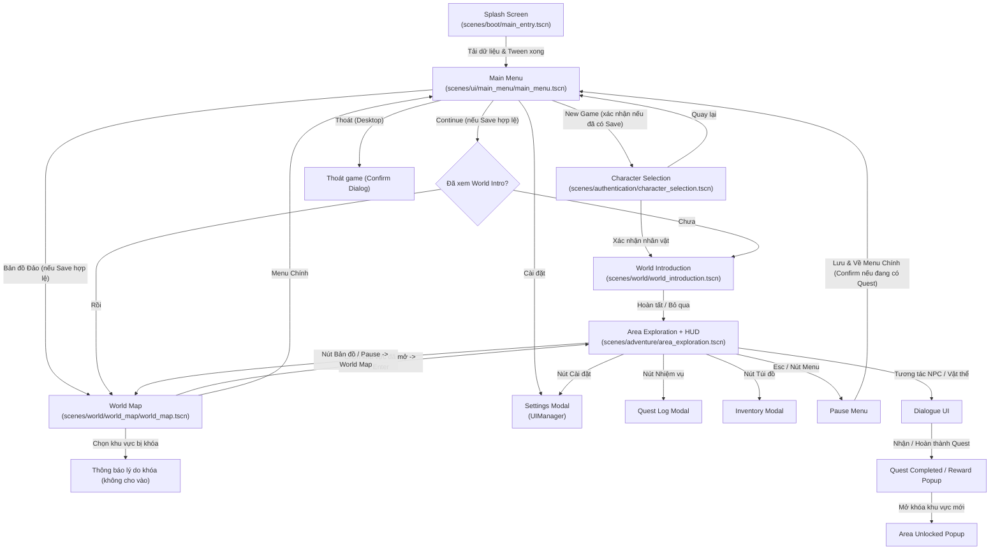

# SCREEN FLOW & NAVIGATION ARCHITECTURE
# PROJECT: ENGLISH ADVENTURE (PROMPT 03)

> **Điều hướng tập trung:** `SceneRouter` (`scripts/core/scene_router.gd`) + `UIManager` (`scripts/ui/managers/ui_manager.gd`). Không để từng màn hình tự quản lý chuyển scene rời rạc hoặc bỏ qua kiểm tra khóa khu vực.

---

## 1. SƠ ĐỒ LUỒNG MÀN HÌNH CHÍNH (MERMAID)

---

## 2. CHI TIẾT CÁC LUỒNG QUAN TRỌNG & BẢO VỆ DỮ LIỆU

1. **Splash → Main Menu:** Khởi tạo theme, localization, settings, hiển thị animation logo + thanh tải mượt, sau đó gọi `SceneRouter.go_to_main_menu()`.
2. **Main Menu → Continue / New Game:**
   - Nút `Continue` kiểm tra `SaveLoadManager.has_save_data()` và dữ liệu đọc được hợp lệ; nếu chưa có save thì `disabled = true`.
   - Nút `New Game` mở `ConfirmationDialog` cảnh báo trước khi reset dữ liệu nếu đã tồn tại file save hợp lệ.
3. **Character Selection:** Yêu cầu người chơi chọn `Boy Adventurer` hoặc `Girl Adventurer` và nhập biệt danh tối thiểu 2 ký tự (kèm gợi ý tên nhanh) trước khi xác nhận để tránh chọn nhầm.
4. **World Map Guard:** Mọi chuyển cảnh vào khu vực (`SceneRouter.enter_area(area_id)`) đều kiểm tra `GameStateManager.is_area_unlocked(area_id)`. Khu vực bị khóa không cho nút `Enter` và hiển thị rõ lý do mở khóa.
5. **Sequential Popup Flow trong Gameplay:** Khi tương tác vật thể/NPC vừa mở thoại vừa hoàn thành nhiệm vụ và mở khóa khu vực mới, hệ thống xếp hàng tuần tự: `DialogueBox` → (đóng thoại) → `QuestCompletedPopup` (`RewardDisplay`) → (nhấn *Tuyệt vời!*) → `AreaUnlockedPopup`, tuyệt đối không mở chồng 3 bảng cùng lúc và chống cộng thưởng lặp qua khóa `_reward_claim_locked`.
6. **Safe Exit from Pause / Settings:** `UIManager.request_exit_to_main_menu()` kiểm tra nếu còn nhiệm vụ đang làm (`active_quests`), hiển thị `ConfirmationDialog` xác nhận lưu toàn bộ tiến trình trước khi về Main Menu.
